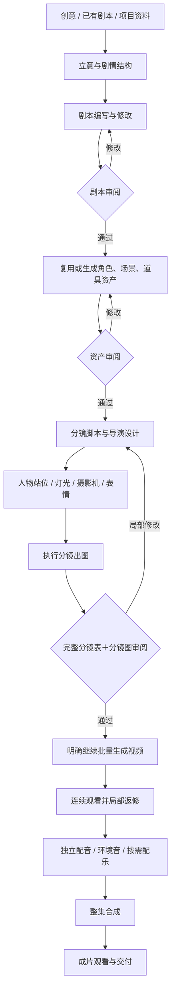

# 当前漫剧创作流程

更新日期：2026-10-25。本文描述当前产品的创作流程与使用方式。

## 一、产品形态

以 Codex / Agent 为创作入口，通过 Skill 调用已有创作和生产能力。画布展示可编辑的核心节点与产物，用户可以手动调整，也可以让 Agent 编排和操作。

- Agent 负责理解意图、写作、导演规划、调用生成、检查和局部返修。
- 画布展示立意、剧本、资产、分镜表、分镜图、镜头、视频导演、配音、音乐和合成等核心产物。
- 导演工作区以“分镜表＋分镜图”为主；3D 调度辅助控制画面；预演按需使用。
- 手动和 Agent 操作使用相同的数据与服务。已有节点和成功产物优先复用。
- 日常操作以修改当前内容、保存、生成和查看结果为主；历史与并发校验保留在内部。

## 二、整体流程

默认在**剧本、资产、完整分镜**三处停下来审阅。完整分镜通过后，仍需明确继续视频生成。用户指定自动模式时可以跳过这些审阅点，但指定的停止阶段仍然生效。

## 三、逐环节创作

| 环节 | 输入与操作 | 输出与检查重点 |
| --- | --- | --- |
| 1. 创作设定 | 输入创意、已有剧本或资料；明确集数、时长、画幅、风格、受众、不能改动的事实 | 本次创作范围与约束；区分用户原文、参考资料和 Agent 新增内容 |
| 2. 立意 | 明确主角想要什么、遇到什么阻碍、如何选择、造成什么后果，以及本集转折 | 能说明因果关系的故事梗概和节拍结构 |
| 3. 剧本 | 按场景写行动、对白、情绪变化和结尾；已有完整剧本优先保留，改编另行标明 | 当前剧本；检查剧情因果、人物动机、对白归属、场景顺序和跨集连续性；完成剧本审阅 |
| 4. 视觉资产 | 先查资产库；复用或生成角色造型、服装变体、场景、360 场景参考和道具 | 实际资产图和复用清单；确认人物身份、造型、场景地标、道具状态及风格；完成资产审阅 |
| 5. 分镜脚本 | 把剧情节拍拆成承担叙事任务的镜头，明确动作、反应、信息揭示与镜间承接 | 可编辑分镜表；每镜包含目的、动作、对白、时长、景别、机位、运动、起止状态和资产引用 |
| 6. 导演调度 | 设置站位、视线、道具关系、灯光、摄影机、构图及角色表情/姿态；需要时进入 3D 调度 | 共享场景调度、镜头取景和静态画面描述；检查轴线、左右关系、遮挡及首尾状态 |
| 7. 分镜执行 | 选择镜头中的明确瞬间，连接真实资产引用，点击生成；复用已成功的组图 | 分镜图/宫格图；逐格核对人物、动作、场景、光线、构图和道具；表与全部图片一起审阅 |
| 8. 视频导演 | 完整分镜批准后明确继续；使用 MiniMax 导演台准备结构化输入，按当前支持的叙事组与能力批量生成 | 组视频；连续观看剧情信息是否成立、人物场景是否一致、动作与前后镜是否接得上 |
| 9. 声音 | 设计或复用角色音色，导入参考音频并试听采用；按当前对白生成独立配音，处理环境音，按需加音乐 | 固定角色声线、对白音轨、环境音及可选配乐；检查归属、台词、时长和重复对白 |
| 10. 合成与交付 | 按时间线顺序合成实际视频与音轨；检查字幕（如使用）、缺片、空隙、总时长及播放 | 可播放成片；连续观看后判断是否需要局部返修，最后交付 |

## 四、3D 调度如何使用

1. 打开场景调度，使用已有场景参考和人物、道具替身。
2. 在预览中拖动人物、灯光和摄影机，调整位置、朝向与取景。
3. 拖动时即时看到调度示意和输出机位预览；编辑观察视角与最终输出机位分开。
4. 保存调度快照，必要时截取输出机位控制图；控制图绑定到对应分镜生成引用。
5. 点击生成后查看最终分镜图，再根据结果调整。

当前 3D 是可自由移动机位的调度空间。360 图用于空间参考，不等于已经从全景图重建出完整真实几何。替身示意用于表达意图，最终图像由生成模型完成。

## 五、分镜必须回答的问题

- 这一镜为什么存在？给观众增加了什么信息？
- 人物想做什么，实际做了什么，动作造成什么变化？
- 观众能从画面看到哪些证据，而不是只从文字知道剧情？
- 与上一镜之间是因果、反应还是空间承接？
- 人物身份、服装、位置、视线、道具持有和灯光是否连续？
- 本镜末态能否接到下一镜初态？

分镜表与保存的审阅内容使用同一套镜头字段，保留主体、描述、动作、对白来源、镜头意图和状态。修改同一导演版本下的内容后，可以重新形成审阅结果。

## 六、声音的默认策略

- **默认独立配音**：角色声线与单句表演分开管理。
- 音色可以设计，也可以复用或导入参考音频，经试听采用后用于后续对白。
- 克隆/参考音色走现有参考音频与声线链路；实际能力以当前服务支持为准。
- 替换视频中的原对白，保留可用且需要的环境音，避免新旧对白叠加。
- 用户明确选择时可使用 H3 原声；同组对白来源保持一致，避免整组原声混音把旧对白带回。
- 无对白片段无需生成配音；默认不要求口型同步。
- 音乐按剧情需要加入，每条音轨只进入合成一次。

## 七、手动修改、复用与恢复

| 情况 | 当前处理方式 |
| --- | --- |
| 已有合适的角色、场景或组图 | 先复用，只有缺失或不符合当前要求的内容才生成 |
| 用户修改剧本 | 修改已绑定的唯一剧本来源；手动保存、恢复和 Agent 接受修改共享同步规则；受影响审阅失效 |
| 剧本同步发生冲突 | 保留已保存修改和现有生产来源，显示冲突；解决后再继续下游 |
| 修改分镜或 3D 调度 | 保存当前内容，重新生成受影响分镜并重新审阅；保留无关成功产物 |
| 某组视频失败 | 先查询已有任务和产物，恢复原任务或重试失败部分，避免重复提交成功组 |
| 指定“做到分镜为止” | 保存结果后停止，不自动进入视频；自动模式也服从停止阶段 |
| 暂停后继续 | 读取当前进度、文件及任务状态，从未完成处继续 |

## 八、Skill 与能力分工

入口：[nuomi-canvas-production](../../skills/nuomi-canvas-production/SKILL.md)。专业模块按实际任务加载。

| 模块 | 负责内容 |
| --- | --- |
| [creation](../../skills/nuomi-canvas-production/references/creation.md) | 创意/资料到剧本、正式剧本来源与修改同步 |
| [stage-contracts](../../skills/nuomi-canvas-production/references/stage-contracts.md) | 各阶段输入、操作、输出、检查和审阅点 |
| [storyboard-direction](../../skills/nuomi-canvas-production/references/storyboard-direction.md) | 分镜、站位、轴线、灯光、表情和静态画面 |
| [cinematic-direction](../../skills/nuomi-canvas-production/references/cinematic-direction.md) | 剧情因果到可见行动与镜头表达 |
| [visual-continuity](../../skills/nuomi-canvas-production/references/visual-continuity.md) | 资产引用、身份与视觉连续性 |
| [h3-experience](../../skills/nuomi-canvas-production/references/h3-experience.md) | H3 准备、案例参考与能力边界 |
| [voice-and-audio](../../skills/nuomi-canvas-production/references/voice-and-audio.md) | 声线、参考音频、配音和音轨处理 |
| [editing-and-delivery](../../skills/nuomi-canvas-production/references/editing-and-delivery.md) | 合成、播放检查和交付 |
| [recovery](../../skills/nuomi-canvas-production/references/recovery.md) | 查询、恢复、失败重试及成功产物复用 |

## 九、相关资料

- [已确认 PRD](../superpowers/specs/2026-10-25-agent-studio-prd-discussion.md)
- [全部外部参考与落地映射](../research/2026-10-25-studio-reference-map.md)
- [软件交付与验收记录](../superpowers/specs/2026-10-25-complete-studio-acceptance.md)

软件链路已经完成开发验证；真实生成结果仍需连续观看，判断剧情、人物一致性、动作衔接与声画质量。任务成功或导出成功不自动代表成片创作质量通过。
