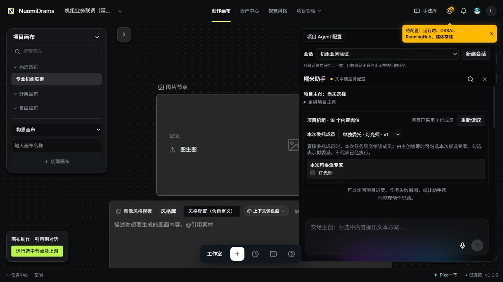
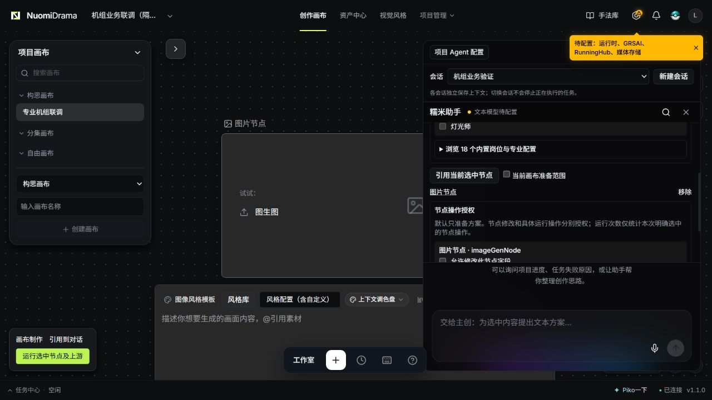

# 项目机组业务页面联调

2026-10-17 在隔离测试项目中，通过实际前后端接口验证。此处为已实现页面截图，不是 Pencil 原型，也不是供应商生成验收。

## 已检查交互

- 18 岗目录按需展开，显示专业职责、方法、交付要求、协作规则及节点能力需求。
- 灯光师固定采用为项目成员 v1，可以单独委托；单独委托默认一次模型调用。
- 引用已有图片节点为任务范围，分别呈现字段修改、生成与编辑授权。
- 点击任务范围中的节点，定位回原画布节点。
- 未配置模型时，发送保持禁用。

完整测试与限制见[接入记录](../../superpowers/reports/2026-10-17-project-crew-integration.md)。
