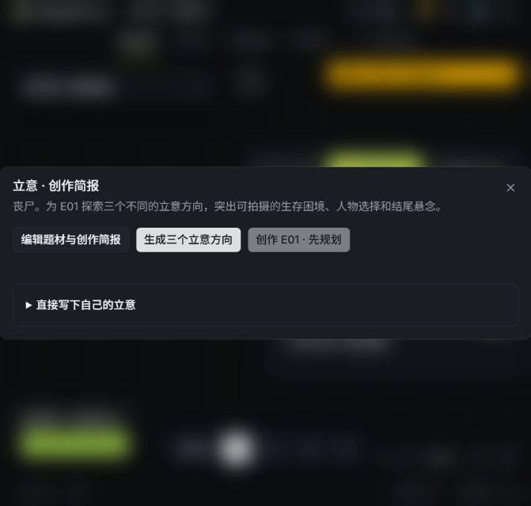
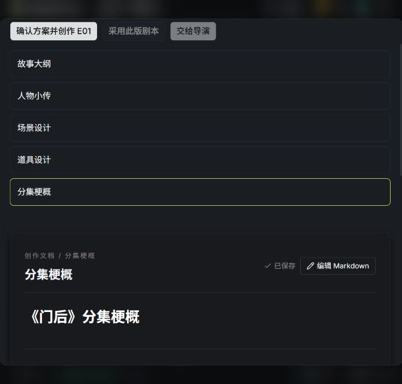

# 丧尸 E01 真机记录（执行中）

使用当前工作区实现，保留已有改动。用户提供故事种子“丧尸”，沿用界面中的三集、每集约 90 秒设置，本次正文与媒体验证范围为 E01。

## 实际来源

- 项目：`01M52RD5QXFD3DFRBKESJ34W18`（夜行者 · 界面校对）。
- 画布：`18e986ab698c485187a9368f3380860f`。
- 验证前端：`http://127.0.0.1:5175`；验证 API：`http://127.0.0.1:8781`。沿用本机项目数据，未替换原 8780 服务。
- 创作简报：`5bd386daa41f4d1cbc6f195190d03d56`，版本 `201fabce62b547db924a850d795cca44`。
- 立意运行：`a7dd507c-4edc-41e6-b9c5-c61ed7eefa3e`，真实生成三个候选，采用高层公寓急救员救援方向。
- 已采用候选：`d036e0d75afa495eacdce49a6311f1bc`，版本 `c26f1dc3013d40608450fd6e926ab04b`。
- 规划运行：`c8f61e4c95614e00a4653f6c8185b668`，已完成并确认；大纲、人物、场景、道具、分集梗概均已保存。
- 正文运行：`82a9e526c7ea4daabecb97c8c81d5a03`，任务 `38b31b75-4bd4-4ac5-acab-e144c0c1ca7d`，以 `needs_review` 结束，草稿及审稿记录完整保留。
- 审查错误地要求 E01 提前兑现第三集的全剧结尾，导致结构返修稿挤入后续剧情。已修正生成提示中的分集范围约束，恢复初稿并压缩一处对白、澄清入户门动作。
- 正文文档 `2cbe9a630fe0464da809009cea405b3d`，修订 `11030ae18d1747c086ab1b9140408f5d`；尚未采用。
- 首次事实检查失败：`evidence quote or codepoint range invalid`。证据定位复用已有精确唯一引用恢复逻辑，未放宽不存在／含糊引用；对应完整一致性测试文件 **14 passed**。需加载修复后再进行真实检查。

## 观察到的交互

采用立意没有自动写正文。启动规划后生成关联文档，规划完成前“确认方案并创作 E01”禁用。确认后进入独立正文运行，保留已确认规划引用。

画布曾收到真实版本冲突。已下载本地 JSON 备份并比较远端：原四个节点均存在且内容一致，远端另有新增节点；随后通过“刷新”保留远端图，没有强制覆盖。

## 验证边界

此记录目前证明立意、规划、正文生成与待修草稿恢复。导演交接、真实组媒体、Qwen 音色、IndexTTS2 克隆、剪辑及成片播放仍须继续验证，不能据此声明 E01 交付完成。

代码验证已观察到：联合业务回归 61 项通过、前端首批 15 项通过、导演 API 请求合同 2 项通过、编排恢复 17 项通过及前端 TypeScript 构建通过。随后新增修复与测试应另行记录。

Gitleaks 预提交检查因 Go 依赖下载超时未能运行完成，不能视为扫描通过。已有 `test_video_source_state_context.py` 的 `director_intent: null` 期望差异已与 HEAD 核对为基线问题，未将其记为本次通过。

## 本轮真实检查与修订

- 重启独立验证服务后，连续性检查 `5d1dab11b1d446b4925f4ccba2868364` 已完成，精确证据定位修复得到真实任务验证。检查指出本集封门已完成，早于梗概的“开始封门”。
- 独立审稿任务 `18d90827-69fd-4794-92e2-8c0a534af07c` 完成，结果 `needs_revision`；正确限定 E01 范围，没有要求兑现 E03。两处问题为血迹空间含混及锁门后仍能下楼。
- 已通过正式 CLI 保存修订 `de807908d37c4a74a2e768d97dba2456`：血迹改为楼道鞋印及伤者台阶滴血；林澈先跨入楼梯平台，邻居在其身后开始拉门拨插销但尚未锁住。结尾保持走向救援的悬念。尚未复审、采用或交接。
- 浏览器控制连续两次超时，转用项目 CLI；随后提交该修订的审稿与连续性检查命令被自动审批拒绝，原文仅为 `blocked by policy`。该命令未执行，未另换接口重发，待恢复授权执行条件后续跑。
- 前端审稿未知回执测试新增后，`production-review-interactions.test.tsx --maxWorkers=1`：**3 passed**。未知提交状态禁用重复提交。
- 实现代理最终报告：重试／草稿恢复最新专测 **12 passed**，较广 API／runner／创作流程 **20 passed**（两组存在重叠，不累加）；最终代码复核与类型检查以对应运行记录为准。

当前仍未生成导演方案、角色音频、组分镜或成片；不得将上述修订及回归结果作为 E01 成片验收。

## 后续核对与用户调整范围

用户明确要求继续后，复核修订仍为 `de807908d37c4a74a2e768d97dba2456`，无重复审稿回执。正式 CLI 成功提交审稿任务 `3b6a1ba3-73c2-4780-b1cc-882a0814050f`；独立的连续性检查命令再次被工具执行层以 `blocked by policy` 拒绝，未进入应用。不能将这类拒绝归因于 Nuomi API、供应商或额度。

该审稿任务随后 failed：`CraftReview` 拒绝模型提供的参考引文，因为该引文不能在 task/reference 中精确匹配（不是当前草稿证据）。这是实际模型结果校验错误，与命令审批拒绝是两件事，未放宽校验或伪造通过。

用户随后明确选择“先只完成 PRD 覆盖核对”，已停止新的真测提交。四份规格仍有实际功能缺口，不仅是缺少真机证据，见 [逐项覆盖核对](PRD-COVERAGE-AUDIT.md)。本轮只更新审计及状态文档，未继续改业务代码。

## 恢复新版画布真测（2026-10-17）

用户重新授权真测，并强调旧 `nuomi-production` 不能替代新版画布流程。验收以当前工作空间节点、连线、固定修订、操作与回执为准；只保留叙事组单位、保存并发、禁止直连供应商与避免重复生产的约束。

- 8781 已按原 `NOVELVIDEO_DATA_ROOT=.runlogs/pencil-reference-data`、`ST_LOCAL_USERNAME=pencil_reference`、`ST_EDITION=ce` 重载当前代码。8780 未改动。
- 浏览器控制 getTab 超时；当前通过画布 CLI 和节点同源 API 验证，不声称已完成界面点击验收。
- 当前画布修订 95，剧本节点 `e9218722-cf5f-4141-870d-ca31c0c691d0` 正确绑定原 E01 文档、修订及确认计划；导演节点尚未绑定剧本，连线仅立意→剧本。
- 发现实测缺陷：`canvas run --node ... --operation inspect` 仍展开依赖闭包，启动了上游立意。运行 `55b0a64a20d64be88d0f9f7262b14762` 已取消；上游任务 `2f76ff54-1832-4be8-9862-0fde52ef0a25` 取消前完成，新候选未采用，原画布仍为修订 95，原立意与剧本引用未变。正在修复专业节点固定输入操作的执行范围。
- 已用剧本节点手动审稿同源 API 提交同修订第二次审稿，attempt `aceedfef2d3d4d61bdb2c78a4417565a`、task `b9a4686f-6389-447b-a7bc-b5eff6c11757`；旧失败回执保留。仍待结果，未采用剧本或启动媒体。
- 实测读取并发：default=3、video=5、world=1、ffmpeg=1，总并发=10，来源 `task-runtime/concurrency`。

### 画布操作范围修复与真实回放

- 根因：通用画布入口的 execution_order 未区分固定内容操作，一律展开上游闭包；新版受信任 Agent 的 target_only 路径原本已有隔离，不应将缺陷泛化到所有 Agent 操作。
- 已在 graph/API preflight/RunStore 共用 operation-aware 范围规则，固定剧本、导演和固定声音版本配音操作只执行目标。普通媒体生成仍保留上游闭包。5 项相关回归通过，独立审查无阻塞。旧能力目录数量断言由 19 更新至实际 24，并验证五种新增专业节点存在，该定向用例通过。
- 重载后真实只读运行 `4b8a2c5d3b7c409a8a225344200dc058` 成功：order 只有剧本节点，输出 `screenplay_source`；画布由 95 更新到 96，无立意重跑。
- 局部改写运行 `82823ac804f64f5bbc7848597f87768d`，task `18025afc-fab3-4918-8a8f-65ba74ee7a5a` 成功，生成候选 `0090a564dd2542d99981fdd8d2bf5404`。核对选区外原文保留后显式接受，正文修订 `bc25d67f0136468daa4cd8aa3ef6fdc3`。
- 节点绑定新修订后真实审稿运行 `bb42b82fdb6b499ea95d8db439ead0c3`，task `d384eb30-b393-4bd8-8ab9-45b2262e8274` 完成，仍 needs_revision。有据问题是“声响近了一层”的位置依据不清；另有意见将赶来的住户甲错读为住户乙。未将误读作为改剧情依据。
- 手工仅澄清开场住户乙守门站位、门扇与插销所在侧、拉门先后动作，并移除声源楼层距离推断；已保存修订 `0073e2dffc724fbc8ac164b6608367eb`，未采用。正在核查独立审稿的历史问题继承，避免无记忆重复审稿循环。

### 连续性检查的执行层阻塞仍存在

用户已恢复真测授权后，再次以正式 `script checks start` 为当前 `0073e2dffc724fbc8ac164b6608367eb` 准备并提交连续性检查，工具执行层再次直接拒绝：`blocked by policy`。整个 shell 命令未执行，没有新检查任务或正文变更。已请求用户处理执行策略，未改用其他接口重发。此问题独立于应用审稿历史缺口；导演交接要求同版已完成的实际连续性检查，当前不能声称交接或成片可继续完成。

### 手动复审历史修复

- `execute_screenplay_review` 原先把 `issue_history` 固定为空，现改为同文档真实父链上、同确认规划及完整依赖修订、候选正文 hash 匹配的最近有效审稿。
- 只继承最近有效审稿的现存 issues 和必要 prior_issue_id 祖先；最近有效 passed 且 issues 为空时截断历史。缺失必要祖先明确失败；未解决 blocker 不能静默通过。
- 提示增加当前正文证据与人物身份核对，前版正文单独标为历史，固定 reference 引用定位未放宽。
- 7 项相关回归通过，ruff 通过，独立代码审查无阻塞。服务已重新加载准备真实复审。

### 执行策略拒绝的只读排查

用户要求给出拒绝原因后，核对了本地 Codex 配置、规则与可读取诊断数据库：

- `C:/Users/Frank/.codex/rules/default.rules` 有 292 条 allow，0 条 prompt/forbidden/deny；没有 production_cli 或 script checks start 的规则。
- 被拒 PowerShell 调用包含“准备请求 JSON，然后运行 checks start”。请求 JSON 文件不存在，符合 CreateProcess 阶段整体拒绝、尚未执行任何子步骤的返回；不能据此断言规则具体匹配了哪一段命令。
- 可读取的日志没有这次拒绝的命中规则或审核理由；工具唯一理由仍为 blocked by policy。
- 结论：定位到工具执行层策略拒绝，但具体规则和触发依据无法从现有诊断中确定。没有证据归因于用户禁止配置、Nuomi API、供应商或额度；撤回要求用户盲目修改配置的建议。未读取凭据文件，未修改策略，未改接口规避拒绝。

### 当前修订审稿通过

- 真实审稿 task `c217ae48-623a-41da-9b77-43ad944ee7bf`、attempt `5747565ffbf448eeaae7f1739873fdfd` 对 `0073e2dffc724fbc8ac164b6608367eb` 返回 passed；历史问题有明确 resolved/prior 关联，剩一条非阻断声音表现建议，未为建议再次生成。
- 发现第三个实测缺陷：screenplay adapter reconcile 未把 passed 当终态，导致画布 run `3fff7307a45047c08870e10f8202b848` 显示 running。正在补状态映射并接续原回执，不重新审稿。

### 导演交接预览与回执修复

- 当前通过审稿的修订 `0073e2dffc724fbc8ac164b6608367eb` 已通过用户采用契约正式采用。
- 新增绑定该采用修订的导演节点 `e01-director-bound-20261017`，连接既有剧本节点。原有用户移除的节点未恢复。
- 交接预览运行 `0d8b16a091cb4b81a9eb841bae5c8f06` 已返回成功的 provider 回执：两个稳定场景 ID、正文／对白差异、可选交接范围及下游影响。预览不等于正式交接。
- passed 终态映射已修复，passed 与 needs_revision 两项定向回归通过；重载后原审稿 run `3fff7307a45047c08870e10f8202b848` 已恢复为 succeeded（2026-10-17T13:26:29Z），没有再次提交审稿。交接预览 run 同样确认 succeeded。
- 正式交接仍缺当前修订的连续性检查。执行工具拒绝没有公开具体触发理由，不应将其写成用户配置错误。尚未生成分镜图、视频、配音或 E01 成片。

### 2026-10-17 22:19 本轮 E01 制作验收

- 恢复原 8781 验证服务，使用原数据目录与用户；未更换项目或生产数据。
- 正式 CLI 实时核对：E01 文档当前与采用修订均为 `0073e2dffc724fbc8ac164b6608367eb`；`groups --episode 1` 返回空列表。
- 实时保存并发：default=3、video=5、world=1、ffmpeg=1，restart_required=false，各 lane active=0。
- 当前文档的检查列表仍只有旧修订的 completed / failed 记录；没有当前采用修订的检查。
- 已准备 `runtime/e01-acceptance-check.json`，上下文修订来自实时 documents list。
- 正式 `novelvideo.production_cli script checks start --body-file runtime/e01-acceptance-check.json` 在 CreateProcess 阶段被自动审批拒绝，仅返回 `blocked by policy`。未进入应用、未创建任务，未换接口绕过。
- 验收结论：阻塞，未通过。当前无叙事组，尚不能验收组分镜、组视频、配音、整集合成或最终播放。需执行环境允许该正式检查命令后接续；具体拒绝规则未公开，不能归因于 Nuomi、供应商或用户配置。

### 本轮拒绝原因排查与模拟操作核验

- 实际通过浏览器打开 5173 项目列表并进入既有画布。界面显示 E01 正文 0073e2df 已采用、已保存、任务 completed；素材抽屉显示暂无镜头上下文素材。未提交被拒绝的连续性检查或制作操作。
- 8781 服务日志中的 documents / consistency-runs / narrative-groups / concurrency 读取均为 200；未出现本轮被拒检查的 POST。这与 CreateProcess 阶段拒绝一致。
- 本地 default.rules 为 292 allow、0 prompt、0 forbidden。config.toml 为 on-request/workspace-write，而本会话执行配置为 never/danger-full-access；文件配置不能解释本会话自动审批的具体裁决。
- 只读查询 logs_2.sqlite：按当前 chat ID 与时间窗口检索 blocked by policy、approval target、e01-acceptance-check 均无匹配诊断。现有可读日志不足以确定命中的规则或审核理由。
- director_plan/workspace.py 的 strict_handoff_context 确实要求当前修订已完成的 actual consistency check；此项是应用交接前提，与执行工具拒绝分属两层。
- 界面另有运行时、媒体存储待配置提示，未据此断言其造成工具拒绝。5173 页面不作为 8781 服务请求证据，两套服务均在监听。
- 模拟操作中还观察到节点不在当前可见视野、点击导演入口后进入视觉风格页，以及适合屏幕控件的浏览器命令分发超时；尚未完成归因，不据此修改业务代码或宣称导演面板验收通过。
- 结论：确认工具执行层拒绝，具体根因仍未公开。没有绕过该拒绝执行相同提交，也没有将只读界面核验记为成片验收。

### 已定位的高置信度误判机制：Windows 的 start 参数与 URL

本次进一步核查已超出此前“原因不明”的结论：

1. 执行 Desktop 安装目录的 codex.exe --version，返回 codex-cli 0.162.0-alpha.17.2。安装包路径为 OpenAI.Codex_26.1007.9446.0_x64__2p2nqsd0c76g0。
2. 对应 tag 的 windows_dangerous_commands.rs 第 34–50 行：URL 出现在任一参数且任一 token 为 start 等启动词时返回 dangerous，没有要求 start 位于命令位置。原请求中的 --base-url 和 script checks start 符合该条件；start 是 Nuomi 的业务子命令，实际并未调用 PowerShell 的启动 URL 命令。
3. 同 tag exec_policy.rs 第 759–765 行：危险命令在 AskForApproval::Never 下转为 Forbidden；第 1056 行 Other 分类返回 blocked by policy。这与本会话实际配置和错误文本一致。
4. 官方修复 PR #54076 于 2026-10-14 合并，明确修复 literal start 参数误认成 URL 启动以及跨命令拼接误判，保留真实 URL 启动等保护。
5. 当前读取的 latest release 为 0.163.0；其 windows_dangerous_commands.rs 仍有旧逻辑，不能承诺安装此 CLI 版本会解决。独立 CLI 更新不等于 Desktop 内置执行器更新。

证据强度：本机捆绑版本、同版本源码、原始命令与错误链高度吻合，构成高置信度原因定位；仍缺本次请求绑定的内部 classifier 决策跟踪，未声称已拿到该内部日志或完成修复后的运行回归。没有通过改写命令/改用 UI 重发被拒请求，没有修改权限或安全检测。

避免复发的受支持修复路径：使用明确包含 #54076 的官方 Desktop/内置执行器版本，并验证实际版本与修复；更新后先验证官方非业务回归案例及实际审批配置，再在核对无重复任务后恢复原 E01 操作。若 Desktop 渠道未提供修复，应向官方提供本记录中的最小错误特征、捆绑版本和 PR 编号，要求给出受支持版本。尚未对外发送报告。

来源：
- https://github.com/openai/codex/blob/rust-v0.162.0-alpha.17.2/codex-rs/shell-command/src/command_safety/windows_dangerous_commands.rs#L34-L50
- https://github.com/openai/codex/blob/rust-v0.162.0-alpha.17.2/codex-rs/core/src/exec_policy.rs#L759-L765
- https://github.com/openai/codex/pull/54076
- https://github.com/openai/codex/blob/rust-v0.163.0/codex-rs/shell-command/src/command_safety/windows_dangerous_commands.rs

另发现的桌面 AppServer WebSocket 连接异常没有请求级关联证据，不作为本次策略拒绝原因。

### 官方修复渠道执行结果

- 用户要求修复后，执行官方 Store 产品 9PLM9XGG6VKS 的 winget upgrade（精确 ID、msstore 源、非交互）。返回：找不到可用的升级；配置的源中没有可用的较新的包版本。未安装任何包。
- winget list 确认产品为 ChatGPT，安装版本 26.1007.9446.0；Get-AppxPackage 显示同版本且 Status=Ok。
- 较早桌面 updater 日志曾显示 manifestBuildVersion=26.1013.4894.0、hasUpdate=true；与当前 winget 查询存在渠道/时点差异，不能据此保证该版本可安装或包含修复。
- 官方 Windows 部署文档提供 https://persistent.oaistatic.com/codex-app-prod/ChatGPT-x64.msix。对该地址的本地 HEAD 请求超时，收到 0 bytes，未下载或安装。
- 当前修复未完成。未修改 Nuomi 业务代码、审批规则、检测逻辑，也未替换 Desktop 的内置可执行文件。需要可获取且明确包含官方 PR #54076 的 Desktop 更新后，再核对实际版本并执行回归。单独更新 npm CLI 不能证明当前 Desktop 工具已修复。
- 官方部署说明：https://learn.chatgpt.com/docs/enterprise/windows-deployment

### 用户手动更新后的实际验证

- Get-AppxPackage 确认 Desktop 已更新为 26.1013.4894.0，Status=Ok；安装目录内 codex.exe --version 返回 0.163.0-alpha.10.2。
- 对应官方源码仍包含 URL + 任意 start token 的旧分类规则。
- 对更新后当前工具执行环境做无副作用回归：仅用 Write-Output 输出 start 与 https://example.com 两段文字，不发网络请求、不启动浏览器、不提交生产任务。仍在 CreateProcess 前返回 blocked by policy。
- 结论：Desktop 更新已成功，但本次更新后当前执行环境仍存在该误判；不是仅依据旧日志推断。E01 检查未重发，制作验收未完成。
- 源码：https://github.com/openai/codex/blob/rust-v0.163.0-alpha.10.2/codex-rs/shell-command/src/command_safety/windows_dangerous_commands.rs#L34-L50

### Nuomi 连续性检查调用前校验修复

- 发现并用回归测试复现：排队期间引用文档改版，execute 仍把新版本发给模型，直到返回后才发现与任务固定修订不符；上下文读取在异常处理外，读取失败会让检查保持 running。
- 修复：调用模型前核对每份引用修订，变更时记录 needs_rebase 且不调用模型；将上下文读取和提示词组装纳入异常处理，读取失败记录 failed。保留模型返回后的修订校验，防止调用期间编辑导致过期结果落库。
- 新增 3 个回归用例，修复前均按预期失败。修复后针对新用例、正常检查、调用期间改版/错误证据的测试：5 passed, 12 deselected（41.27s）。git diff --check（两个修改文件）通过。
- 完整 consistency 测试和额外 runner 测试因长时间无输出被中止，未计为通过。默认系统 pytest 临时目录不可访问，定向测试使用仓库 .runlogs 下独立临时目录。
- 本次只证明以上 Nuomi 缺陷修复，不证明它们是此前 CreateProcess 策略拒绝的原因。未做真实模型调用、未重启服务、未宣布 E01 制作验收通过。

### 专业剧本检查入口与交接恢复

- 用户截图确认：专业剧本处于交接预览，右栏只显示英文缺少当前检查错误；原检查入口位于不显示的审阅与修改页签。
- ScreenplayNode 将既有 ScreenplayReview 移至常驻详情栏，并将缺少当前检查错误译为具体中文操作提示。没有跳过后端检查条件。
- 回归：screenplay-workspace.test.tsx 9 passed（--testTimeout 30000）；修复前新增阅读视图检查区断言按预期失败。普通超时一轮失败后仅提高测试等待上限，未修改运行逻辑。浏览器验证专业剧本详情中实际显示“检查当前剧本”和 completed，截图 runtime/e01-professional-check-fixed.png。
- 新实际检查 fd25ac7d19f040329b3be1c4b80d3a86：当前正文 0073e2df，completed，0 issues。
- 经正式 CLI director-workspace prepare 完成交接 2dc472c6df15450e9160cf9bbbcba606；语义任务 6dcbea60-e6d8-4e88-ad08-25b1f6fa566f 完成。
- 语义候选 01M557J6H33422Q5N03SF6ACWR 仍有 unsupported_script_fact / uncovered_story_block，已通过受支持 repair 接口提交 9327884b-5bdd-45d0-b283-62907ff14031，并发按已保存 default=3。尚未生成图片或成片，验收未通过。
- 语义修复完成：新修订 01M557QV33F1Q6KEBTCH2BX1ZV，1 个目标场景已修复，0 剩余问题，已正式激活。
- 导演规划任务 324c710d-39c9-41ed-a183-593be47c2065 执行约 6 分 43 秒后失败，CODEX_STRUCTURED_OUTPUT_INVALID。批量协调器已正常结束，未提交图片任务。
- 已查对应 author session 的 Nuomi 自动校验反馈：首次 groups=[]，第二次 groups.0.shots.4 creative_source_mismatch。最终输出已留存 runtime/e01-director-invalid-output.json，未强行注册为通过。此问题属于后续导演结构输出校验，非按钮缺失或交接失败；仍待进一步修复，E01 成片验收未完成。

### 导演结构契约修复与真实续跑（2026-10-18）

- 离线复验保存的失败输出：`groups.1.shots.1.creative` 使用 end 锚点，却缺少 `end_cinematography` 与 `optics.end_focus_target`。Nuomi 提示词/schema 未明确这组条件依赖；另一次失败仅返回 `creative_source_mismatch`，没有指出哪个来源引用不属于当前镜头。
- 修复模型 schema 描述、作者/审查/修复共用提示词，并向模型反馈具体引用字段与缺失 source ID，保持原校验约束。导演定向测试 23 passed。
- 真实导演任务 `20db580a-d3a0-4dd4-afc2-0431a1c19c92` 完成，方案 `01M5595GATC5BXVY5MGK6D5J4S` 校验通过并已激活；两个叙事组、七个内部镜头。生产仍按组，不按镜头提交。
- batch 在必需资产预检停止：四个角色和两个场景的素材库为空。已通过正式 API 创建文字档案并补齐素材。
- 真测选角入口又发现 Windows CRT 无法用 `os.open` 打开目录，提交日志原子替换后抛 PermissionError，返回 500，尚未 enqueue。修复 submission/store/recovery 三处目录 fsync 的平台处理，保留文件 fsync、原子替换与 POSIX 目录同步。
- Windows 回归新增三项修复前均失败；修复后相关存储与 Windows 用例 21 passed。提交/采纳等首轮 64 项中 63 passed，唯一失败为旧测试硬编码 POSIX 同步次数，已改为平台对应预期并复验通过。
- 重启验证服务 8781，真实选角方案任务林澈、住户甲、住户乙已完成；开始按保存并发 3 生成角色设定图。尚未完成整组分镜、视频与成片，不能计为 E01 制作验收通过。
