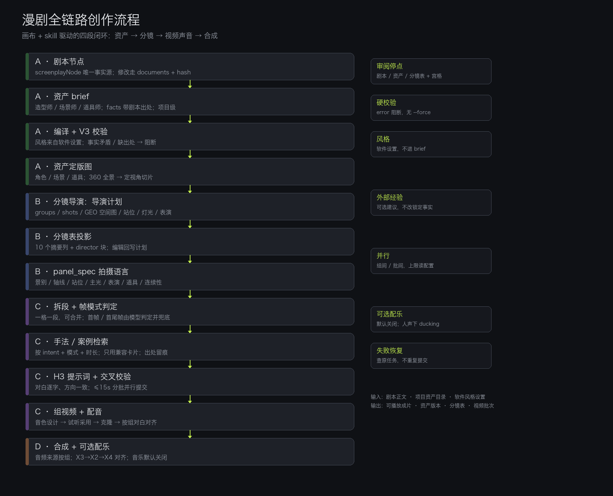
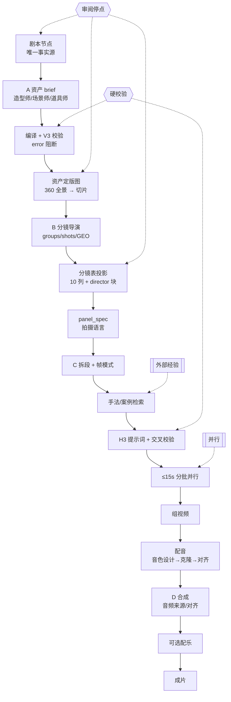
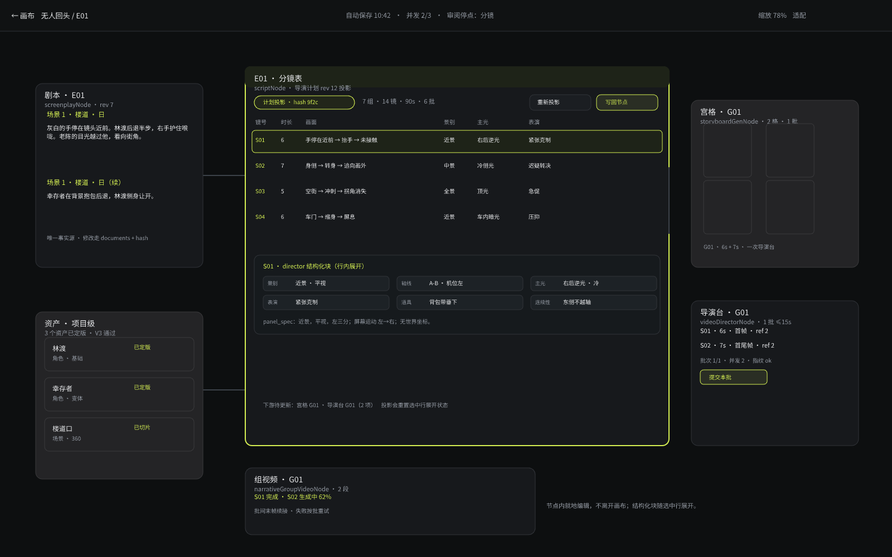
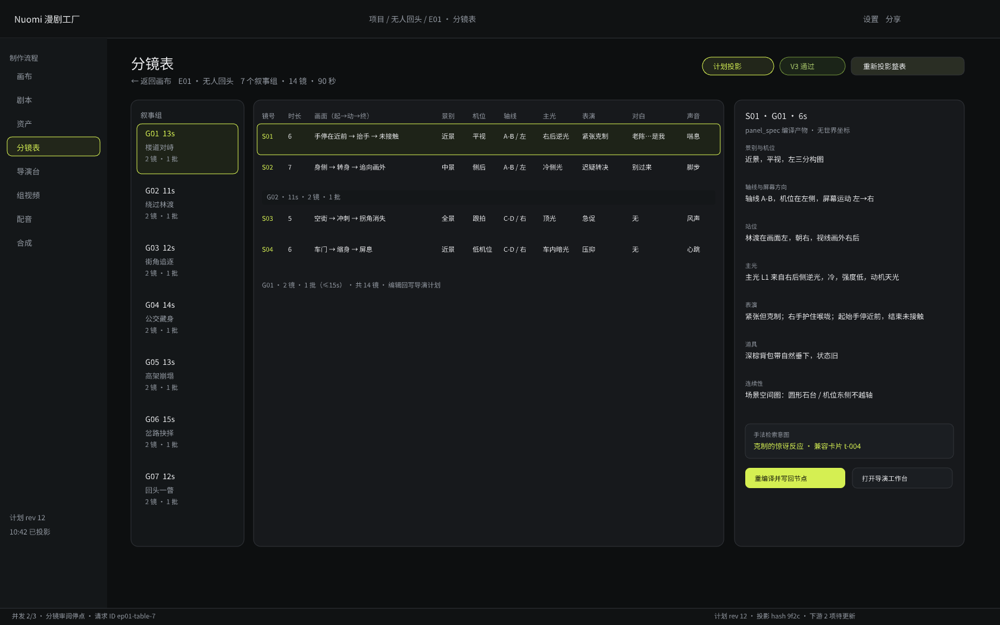

# 漫剧全链路创作流程图（2026-10-19）



Mermaid 源（便于评审与后续修改）：



## 读图要点

- **A/B/C/D 是四个可独立验收的切片**，箭头表示数据依赖，不表示必须串行开发。
- **三个审阅停点**：剧本、资产、分镜表+宫格；停点由 progress 的 `review` 策略控制。
- **两道硬校验**：资产 V3、H3 交叉校验；error 一律阻断，无强制放行。
- **风格**只来自软件设置，不进入任何 brief 或 panel_spec。
- **外部经验**只在 C 的段规划后检索，且只接受兼容卡片；不改锁定事实。
- **并行**发生在组间与批次间，并发上限读项目已保存设置。

## 画布中心交互稿（pen.dev）

用户否决“独立 tab 页面”，交互必须以画布节点与产物为核心。pen.dev 文档里：

- 帧 **24 分镜表 · 整页稿** 标记为废弃方向（保留作对照，不再使用）。
- 帧 **25 画布 · 分镜表节点展开** 为当前方向：



交互决策：**选中即展开当前行**；**图片节点沿用当前样式外观，不改**，本次只新增分镜表节点的行内展开与状态徽标。

节点内就地表达：
- 剧本节点、资产节点、分镜表节点、宫格、导演台、组视频全部在画布上，用连线表达依赖。
- 分镜表节点选中后在节点内展开 `director` 结构化块（chips）与一行 panel_spec 摘要；不跳页、不开 tab。
- 节点头部只保留“重新投影 / 写回节点”两个动作，状态用“计划投影 · hash”徽标表达。
- 底部提示明确“节点内就地编辑，不离开画布”。

旧稿（仅对照，已废弃）：



设计取舍：

- 左侧叙事组列显示组时长、镜数与批数；选中组高亮。
- 中间表格保留 10 个摘要列，行选中后右侧展开 `director` 结构化块（景别/轴线/站位/主光/表演/道具/连续性）。
- 顶部三个状态：计划投影、V3 通过、重新投影整表；底部状态栏显示并发、审阅停点、投影 hash 与下游待更新数。
- 主要操作只有两个：重编译并写回节点、打开导演工作台；不提供“强制放行”。

待确认：

1. 结构化块放在右侧详情，还是改为选中行下方内联展开？
2. G02 这类组间分隔是否需要常驻（当前是分组行）。
3. “重新投影整表”是否应显示影响范围（哪些下游会标待更新）？
4. 表格是否需要列宽拖拽与横向滚动（10 列在 1440 宽下偏紧）。

## 前端触点（待讨论）

| 位置 | 需要的前端变化 | 交互问题 |
| --- | --- | --- |
| 分镜表 `scriptNode` | 显示 `director` 结构化块；`directorBinding` 状态；编辑走计划 | 摘要列与结构化块如何分层展示？编辑一格时如何提示“这会重投影整表”？ |
| 资产图节点 | 展示 brief 指纹与 V3 issues | 失败时是阻断生成按钮，还是允许查看但禁用主操作？ |
| 宫格 / 单镜头 | 显示 `panel_spec` 与段边界 | 段边界是否需要可视化（分隔线/徽标）？合并段如何表达？ |
| 导演台 | 批次（≤15s）与帧模式徽标 | 自动分批后，用户看到的是“一组多批”还是“一个时间线”？ |

## pen.dev

本机 `pen` CLI 已安装，但当前 **未登录**。登录后可用：

```bash
pen login
pen --out docs/design/production-flow-2026-10-19/canvas-flow.pen \
  --prompt "根据图三份规格与 flow.png，画分镜表节点、资产节点与导演台的三屏交互，深色主题" \
  --export docs/design/production-flow-2026-10-19/canvas-flow.png
```

已有文档：`~/.pencil/documents/4514de9e-.../untitled.pen`（轻量画布原型）。
