# NuomiDrama 用户手册

## 阅读说明

适用版本：2026 年 10 月 7 日核对的 NuomiDrama 本地工作台（界面标识 v1.1.0）。本手册覆盖项目、剧本、资产、分集制作、画布、工作室、助手及运维设置的用户操作。模型可用范围、参数和按钮状态由当前服务配置与输入决定。

截图来自实际运行界面，使用已有项目说明位置与状态；示例中的角色、进度、费用及失败记录不是新项目的默认值。截图中的“待配置：媒体存储”用于说明配置提醒。操作时请以自己项目的名称、版本和提示为准。流程图均为说明性示意图，不是界面截图。

第一次使用：先阅读第 2 章完成配置，再按第 3 章制作一集。查某个按钮：按第 4—11 章查对应工作区。遇到失败：阅读第 12 章，再回到出错的制作位置处理。

## 1. 认识工作台

### 1.1 产品能完成什么

NuomiDrama 将剧本创作、人物与场景资产、分镜、视频、声音和成片放在同一项目中。你可以沿“剧集制作”按集推进，也可以在“创作画布”连接素材与生成节点，探索单个片段或组织整集。工作室提供角色造型、导演方法、三维预演和片头等专门工具。

### 1.2 工作区地图

|入口|主要操作|完成后得到|
|---|---|---|
|项目管理中心|新建、搜索、排序、归档、回收站|作品项目与管理状态|
|剧本导入|已有分集剧本导入、小说解析、知识图谱|可制作的剧集与原文|
|剧本创作|设定、写作、候选改稿、关联检查、交接|确认后的创作正文|
|资产中心|角色、身份变体、场景、道具、声线|供生成引用的采用资产|
|剧集制作|脚本校对、导演审核、分镜、视频、合成|连续片段与成片|
|创作画布|节点、连线、参考、生成、提交|自由候选或正式制作结果|
|创作工作室|Agent Team、角色造型、导演、预演、片头|方法版本、设计稿、参考及片头|
|视觉风格|预设、自定义风格、应用到项目|项目默认视觉方向|
|任务中心|查看进度、错误与结果|定位处理入口|
|项目费用|费用、计价、订阅、补算|成本记录和估算|
|糯米助手|项目内对话、附件、语音、工具反馈|建议或可核对的操作结果|

顶部品牌图标返回项目管理中心；项目名称下拉切换项目；全局右上角提供手法库、设置、通知和个人信息。底部任务状态可快速查看后台活动。

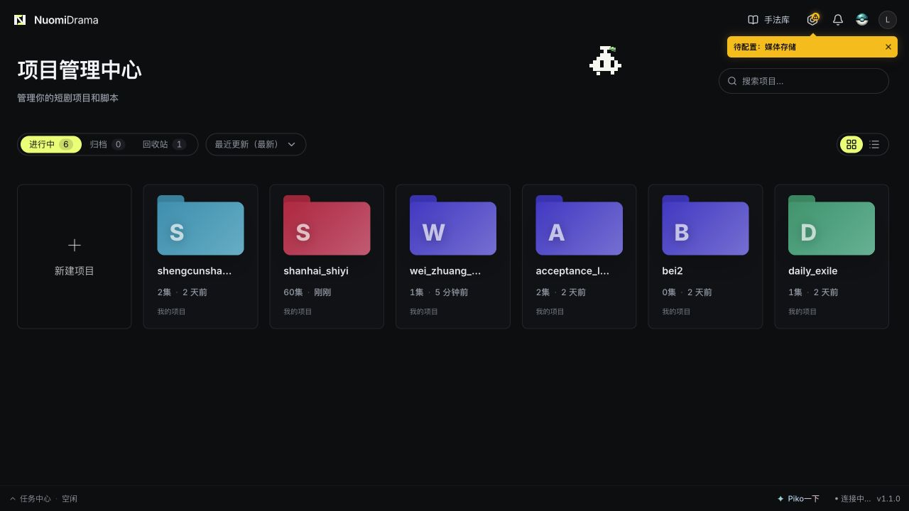

### 1.3 必须分清的对象与动作

项目是一部作品的工作空间；剧集是一份分集交付；剧情节拍是一次行动或信息推进；叙事组把相连镜头组织为生成单元；镜头是具体画面安排。基础角色代表“谁”，身份或变体代表“该人物在此阶段的外貌与服装”。

“保存”记录编辑；“生成”创建任务及候选；“采用”选中供后续使用的结果；“激活”使剧本或导演版本成为生产依据；“提交”把画布结果送到明确目标；“启用”使方法配置作用于之后的新任务。看到图片、候选或保存成功，不应直接推断整集已经使用它。

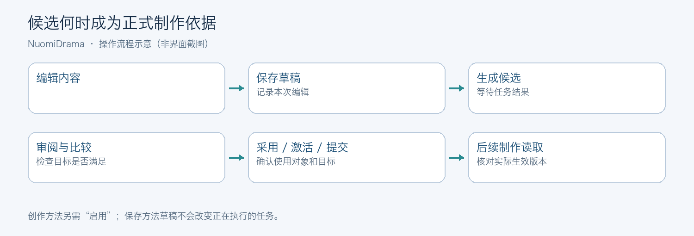

## 2. 首次配置与生成前检查

### 2.1 打开设置并检查连接

入口：右上角设置。当前设置分为“运行时与媒体”“兼容网关（可选）”“媒体存储”，各区域独立保存。先看“制作前检查”的运行时、媒体服务和存储状态，再进入缺失项处理。正在检查或读取失败不等于已配置。

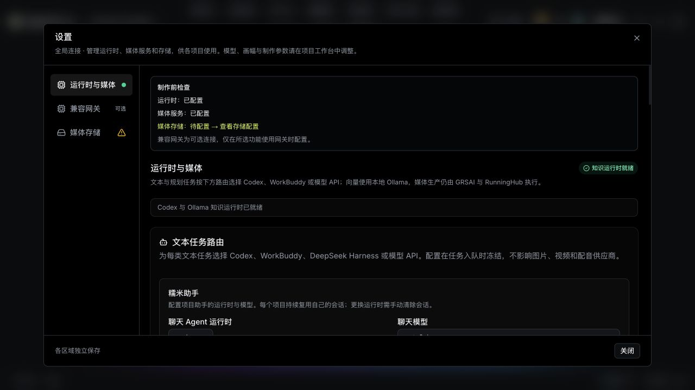

### 2.2 文本任务与助手运行时

1. 在“运行时与媒体”找到需要配置的任务，如剧本创作、解析与规范化、知识提取、导演规划或 H3 提示词。
2. 选择执行运行时，再选模型及推理强度。可选运行时包括界面列出的 Codex、WorkBuddy、DeepSeek Harness、模型 API，实际可用性取决于安装与连接。
3. 点击“保存任务路由”。任务入队时会记录配置，修改不会自动改变已经创建的任务，也不会替换图像、视频及配音供应商。
4. 糯米助手使用独立的“聊天 Agent 运行时”“聊天模型”“聊天推理强度”，点“保存聊天 Agent”。更换助手运行时后，按页面说明手动清除旧会话再开始。

DeepSeek Harness 使用统一模型与推理强度，对应任务行体现继承状态。若模型候选为空，先检查运行时连接与模型配置；不要把空下拉当作任务已能执行。图片视觉检查需选择支持图片输入的运行时。

### 2.3 图片、视频、配音服务

在“媒体生产服务”分别填写供应商服务地址和 API Key。GRSAI 区域选择图片模型及最大并发后保存；RunningHub 区域填写服务地址、Key、并发和对应已发布工作流 ID 后保存。图生视频与多参考图是不同配置，不能只填其中一个就假定另一个也可用。

RunningHub 页面还提供图片超分、Qwen3 音色设计、IndexTTS2 声音克隆等工作流项。请填写自己的有效工作流 ID，不照抄截图示例。生成页的模型、画幅、时长等制作参数在项目工作台调整。

兼容网关仅在所用功能依赖网关时配置：进入该分类，维护服务渠道与模型连接，保存后回生成入口检查模型是否可选。已有凭证按页面说明处理，避免将占位符当作真实 Key 保存。

### 2.4 媒体存储

入口：设置 → 媒体存储。它负责让上游模型访问本地参考素材，不能用“本机能打开图片”代替存储配置。

1. 选择阿里云 OSS 或 Cloudinary。
2. OSS 填写 AccessKey ID、Secret、Bucket、Endpoint/地域及签名有效期；Cloudinary 按其表单填写对应账号配置。
3. 点击该提供商的保存按钮，确认状态变为已配置。
4. 回到需要参考图的页面，检查素材已选并已保存，再生成。

未配置时，纯文本和纯文生图通常不受影响；依赖上传本地参考图的图生图、身份图、首帧和图生视频可能失败。留空保持已保存值等规则以表单说明为准。

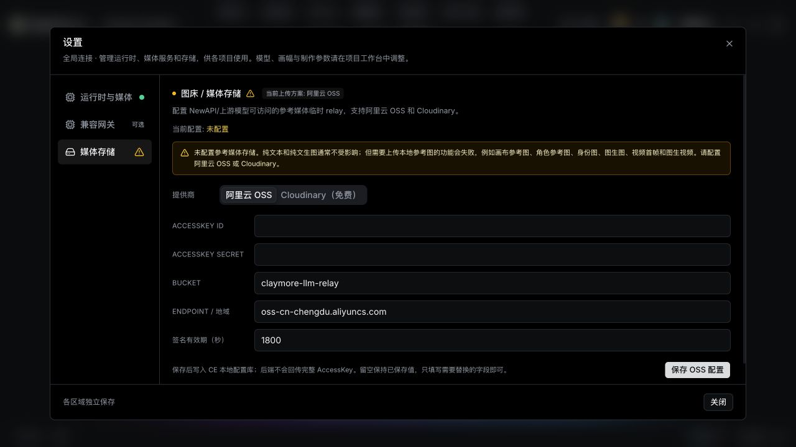

### 2.5 并发、本地向量与保存

“任务并发”分别配置普通任务、视频任务、世界构建和 FFmpeg 的上限，点“保存并发设置”；当前界面明确要求重启服务后生效。提高并发还应考虑供应商额度与机器资源，不代表单个任务一定更快。

Ollama 区域填写地址、选择已安装 Embedding 模型、设置批量大小，点击“测试并保存”；模型列表不完整可先“刷新 Ollama 模型”。该操作会真实调用模型并记录向量维度。关闭设置前确认相应区域已经保存；未保存提示出现时选择继续编辑或明确放弃。

## 3. 快速上手：做出第一集

建议先用角色少、场景明确的一集跑通流程。已有剧本从“剧本导入”开始；只有想法则从“剧本创作”建立框架、审阅正文并交接制作。

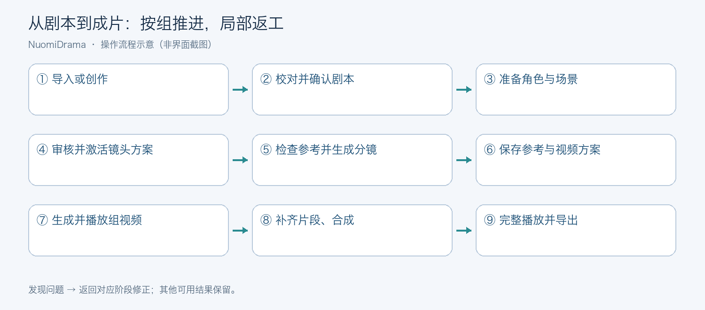

1. 创建或进入项目，确认项目名称、类型与视觉风格。
2. 导入一集剧本，核对集号和原文；原创内容先审阅并交接。
3. 在资产中心准备角色基础形象、实际出镜身份、场景和关键道具；需要外部配音时配置声线。
4. 进入“剧集制作 → 叙事组脚本”，解析场次，核对对白及剧情节拍，确认校对版本。
5. 生成镜头方案，在导演审核中检查覆盖、顺序、人物和场景，激活可用版本。
6. 进入“分镜生图”，逐组检查参考、画幅、模型和风格，生成后检查宫格与切分格位。
7. 进入“视频生成”，选模型及模式，保存参考图和视频方案，点击“生成组合视频”。先完成一个组并播放，再扩大制作范围。
8. 进入“整集合成”，补齐缺失组，选择分辨率与字幕，合成后完整播放，最后下载或导出。

成功标准：每个需要的组都有可播放片段，顺序完整，角色与关键道具正确，台词或解说未明显漏段，成片可以正常播放。局部不满意时只返回对应环节，保留其他可用结果。

## 4. 项目管理与剧本导入

### 4.1 新建、查找和管理项目

首页点击“新建项目”，填写弹窗必填信息并确认。创建后从项目卡片进入；搜索框按名称查找，排序下拉调整列表顺序，卡片/列表视图切换展示方式。

每张卡片的“项目操作”管理该项目。归档后到“归档”筛选查看；删除后的可恢复项目到“回收站”查找，按可用操作恢复或进一步处理。删除、覆盖和清空前核对项目名称及影响，避免将归档误当删除。

### 4.2 导入已有分集剧本

入口：项目 → 剧本导入 → 继续导入或分集剧本导入入口。

1. 上传 .md、.txt、.docx，可多文件；也可粘贴分集正文。保留“第 1 集”等集号标题。
2. 点击“检查导入内容”，逐项查看新增、冲突、待补充和解析失败状态。
3. 补齐集号并解决同批重复；遇已有集号选择“覆盖”或“跳过”，可用“全部覆盖”“全部跳过”统一处理。
4. 点击“确认导入”，核对确认信息，再“提交导入”。
5. 在“导入历史”查看结果，再“进入剧集制作”。已有分集剧本按原文解析校对，不应当作小说改编入口。

预检失效时重新预检；冲突未决定时不能提交。覆盖已有剧集后，检查提示的下游内容：新原文并不会自动使旧分镜、旧配音和旧视频匹配。关闭未提交弹窗时，可继续编辑或放弃并关闭。

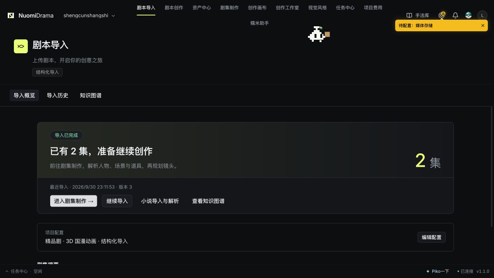

### 4.3 小说导入与解析

1. 点击“小说导入与解析”，选“上传小说”或“粘贴文本”。上传支持 txt/md/docx，建议不超过 10 MB；当前粘贴入口最多 1000 字。
2. 核对项目类型“解说剧/精品剧”、视觉风格与默认人群；需要解说时选择第一人称或第三人称。
3. 点“保存设置”，确认实际选中的数据来源后“开始导入”。
4. 查看字数、章节数、预计集数、结构预览和日志，完成后检查分集与知识图谱。

运行中可停止，失败后重试导入；有格式风险时先“查看详情”。重新导入可能重建图谱并影响下游，按二次确认检查影响。项目类型已锁定时，需按页面要求重新导入才能切换。

### 4.4 导入历史与知识图谱

“导入历史”用于检查批次、时间、版本和处理结果；导入完成与后台知识索引完成不是同一状态。“知识图谱”中拖动平移、滚轮缩放、点击节点查看关系，使用放大、缩小、重置视图及展开功能定位内容。显示失败先重试读取，不必立即重新导入全部原文。

## 5. 剧本创作

### 5.1 三栏工作区与设定

入口：顶部“剧本创作”。左侧是创作文档树，中间是正文，右侧是 AI 协作。创作简报、故事大纲、人物小传、场景设计、道具设计、分集梗概与单集正文共同构成项目写作资料。

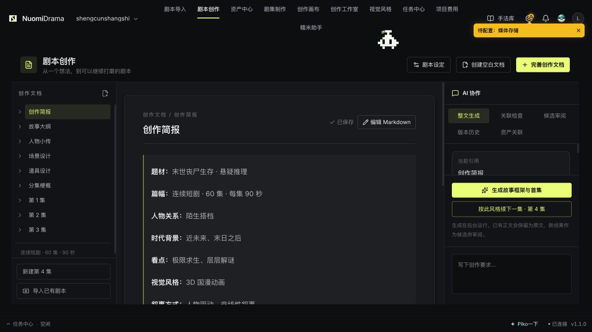

新项目点击“开始原创”或“从创作预设开始”；已有项目点“剧本设定”。选择预设、主题材和可选融合题材，填写受众、角色关系、时代背景、看点、视觉与叙事方向，再填写故事种子。连续短剧可设置 2—100 集；单集/短片使用相应模式，目标时长至少 15 秒。保存创作设定后再生成。

### 5.2 生成框架、续集与手动文档

在“整文生成”填写创作要求，点击“生成故事框架与首集”。已有首集后可“按此风格续下一集”。后台运行期间可查看进度，结束后从文档树打开结果。已有正文会保留，新结果作为候选审阅。

需要自行写作时使用“创建空白文档”“创建创作文档”或“新建第 N 集”；要编辑既有制作剧本，用“导入已有剧本”。“完善创作文档”用于补充工作区资料，先核对所缺文档与任务范围。

### 5.3 编辑与改稿候选

1. 选择目标文档，点击“编辑 Markdown”，修改正文并等待“已保存”，必要时“立即保存”；通过“预览 Markdown”检查呈现。
2. 选中文字或将光标放在目标场，在“候选审阅”选择选段、当前场或当前集范围。
3. 选择对白更自然、增强潜台词、调整冲突、压缩表达或自定义方向；填写补充要求与必须保留内容。
4. 点击“生成改稿候选”，比较原文与建议，再选择“采纳此处”“批量采纳本轮”“放弃”或“继续调整”。

候选不会直接覆盖原文。出现保存失败用“重试保存”；版本冲突用“比较最新版本”，再选择保留自己的修改并保存或使用服务器版本。候选引用的基线已变化时，应基于当前版本重新生成，避免把旧候选覆盖到新正文。

### 5.4 关联检查、创作记忆和版本

“关联检查 → 检查当前集”核对人物、伏笔、场景、道具和对白；有待采用候选时可“检查若采纳影响”。事实冲突先读来源与目标证据；确属创作安排时填写原因并选择“这是有意安排”；需联动修改时勾选具体文档，再“生成关联改稿候选”。创意建议供参考，不作为无限阻断进度的硬门禁。

展开“项目创作记忆”查看当前生成引用的项目经验及报告；核对与本次作品方向是否一致。版本历史可对照旧版与当前稿，再“恢复所选版本”。生成暂停或部分失败时用“继续未完成步骤”；运行中可暂停生成。

### 5.5 资产关联与交接制作

“资产关联”将设定实体对应到已有角色、场景或道具，必要时创建名称未使用的文字资产。先修复缺失或失效关联。

交接步骤：保存全部文档 → 打开目标分集 → “确认本集并交接制作” → 选择采用的设定及资产 → 选择全部场次校对、仅采用正文或所选场次校对 → 处理关联检查及事实问题说明 → “预览交接差异” → 核对正文、场次、对白和资产变化 → 确认交接。

完成后选择“前往本集制作剧本”或“查看校对结果”。预览之后源内容再变化，需要重新预览；场次无法可靠解析时先用全部场次，不强行局部交接。

## 6. 资产中心

### 6.1 通用操作

入口：资产中心，切换角色、场景、道具、声线。先搜索定位资产，再看当前采用结果、资料和历史。场景、道具支持按名称或使用次数排序；引用关系可定位到相关集与镜头。

“导入人物表/场景表/道具表”支持 md/txt：选择文件 → 解析预览 → 检查新增、补全、保留、冲突及警告 → 确认导入。预览不修改资料，确认按规则补空字段，不应假定它会覆盖全部已有字段。预览失效需重新解析。

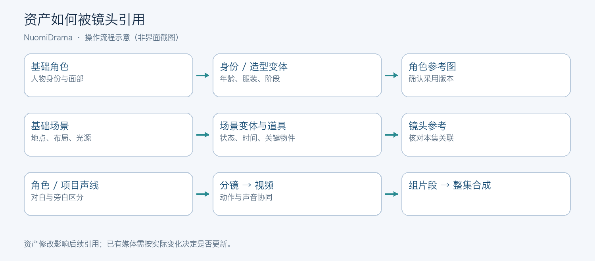

### 6.2 角色基础资料与当前形象

1. 点击“添加角色”，或从创作人物表提取、导入人物表、从原文自动提取。
2. 核对姓名、别名、角色定位、性别、年龄、身形、描述、外貌和面部提示词，保存资料。
3. 从角色列表选人，查看“基础形象”“当前形象”及“原始资料与设计依据”。
4. 需要新设计时“重新选方案”，比较方案再生成候选；需要改现有形象时使用可用的“提出修改”。审阅后采用，查看“历史与修复记录”核对来源。
5. 需要固定人物时使用“锁定角色”；“设为主角”服务于项目角色定位和相应解说流程。不要把“删除角色”当作清除一张图片。

自动重新提取可能影响现有角色资料，先读确认提示。尚标注“暂未实装”的批量肖像入口不属于可用制作步骤。

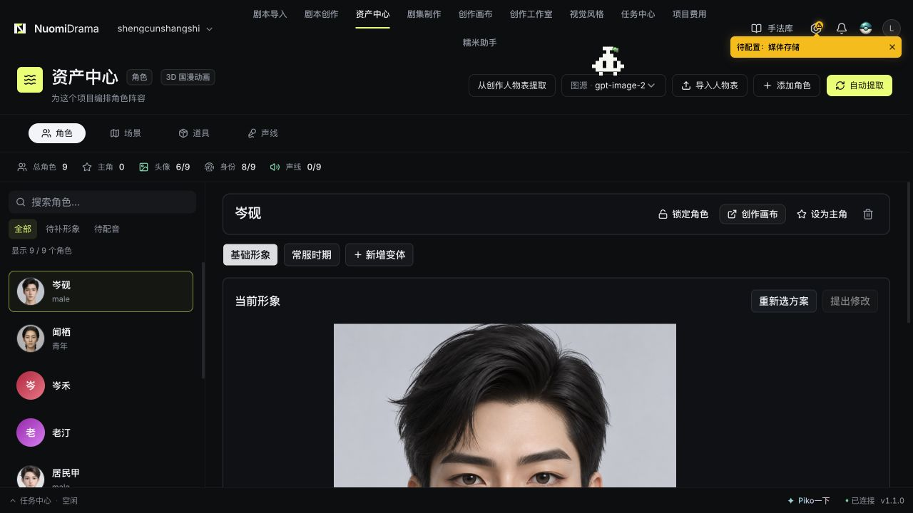

### 6.3 身份、服装与外观变体

选角色后使用“＋ 新增变体”或身份添加入口，填写该阶段名称与服装外观；需要时上传服装参考。年龄、感染等变化填写在身份外观变体中，未覆盖项继承基础角色。生成身份图或上传候选后，检查正背面、服装、脸部及角色一致性，再“采用此版本”。

历史版本可重新采用或删除，删除图片与删除身份记录是不同操作。部分版本布局不同，不按固定宫格位置猜测含义，应以候选标签为准。QC 服务暂不可用时，若页面提供“已核验，继续采用”，人工检查后可继续，不必反复付费重画。当前采用版本被删除后的替代规则依页面提示核对。

### 6.4 角色声线与项目解说声线

角色详情顶部选择“声音”，也可点击角色列表旁的声音按钮直达。默认声线供角色使用；年龄变体在更多设置中单独管理，否则继承默认。

声音设计先读取人物身份、年龄、描述和项目影视风格，准备“稳定声线”和“本次试听表演”。可以直接编辑音区、质感、吐字、节奏、情绪和重音；“听感更年轻”“减少沙哑”“表演更克制”只修改文字方案，不生成音频。日常交流、冲突对峙、低声表达用于准备不同的短试听文本。

确认描述和台词后点击“一键生成声音”，每次生成一个候选。试听满意后采用，采用前保留当前声音；历史候选仍可查看。生成失败保留输入，修改后可重试。采用不会自动重做已有配音或视频。声音描述、试听和实际后续配音引擎的表演控制能力可能不同，应以实际音频为准。

上传：选择清晰的人声样本 → 试听 → 按需“裁剪到 3–5 秒”，填写起始位置和保留时长 → 保存。录音：开始录音 → 停止 → 试听 → 保存。AI 设计音色需要对应服务配置，生成后同样试听并采用。

第一人称解说需要先确定解说主角与其角色声线；第三人称使用“声线”页的项目解说声线，可上传、录音或从“项目音频”选择，历史样本可展开查看。角色对白与项目旁白不要混绑。

麦克风不可用时检查浏览器权限、设备及占用；录音通常要求 HTTPS 或 localhost。没有配置声线时，外部配音步骤可能无法继续。

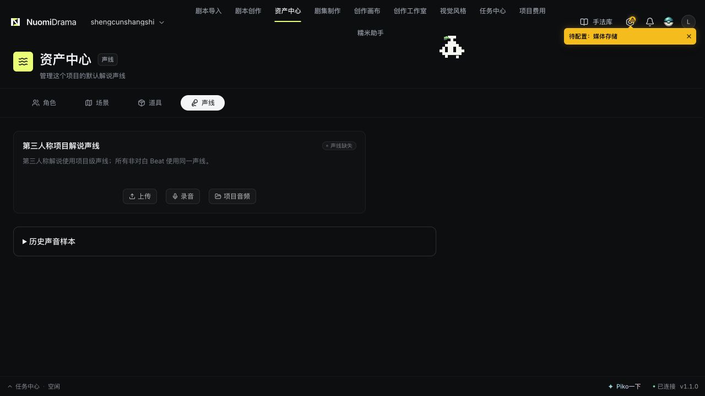

### 6.5 场景、变体、全景与导演世界

“场景 → 新建场景”，或从创作场景表、图谱、文件导入。填写名称、类型和环境描述；建议明确门窗、通道、光源、材质与禁止元素。同地点在昼夜、破坏前后等状态变化用“添加场景变体”，增量提示词只写变化部分。

选场景后使用四个区域：参考视图查看源图、背面、360 全景；属性与变体编辑设定；3D 场景构建或打开导演世界；历史比较已有结果。

在对应参考槽位使用“上传源图”“重生源图”及其背面/全景操作。更换提示词后旧参考可能提示需更新。打开 360 查看器，调整视角后下载截图；全景是取景依据，不代表所有角度都已生成最终镜头。

3D 场景可由参考构建导演世界或上传支持的自定义包，等待就绪再打开。可通过“创作画布”继续编辑场景，或复制资产链接定位。已有派生场景时，全量图谱重建可能不可用，避免误覆盖变体。

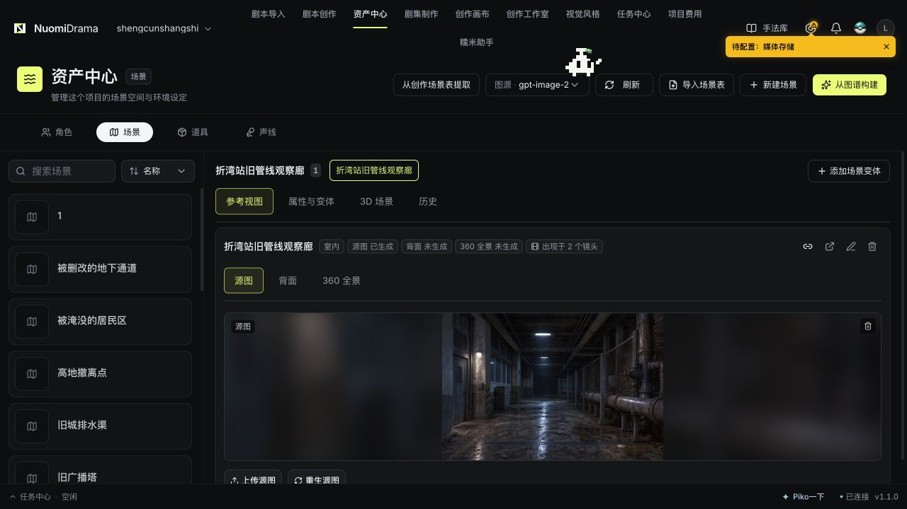

### 6.6 道具

进入“道具”，新建或导入道具表，也可从创作道具表提取。填写名称、类型、所属角色、视觉提示词，保存后“生成参考图”或“上传道具”，检查并采用结果。需要多件参考时使用支持的批量生成入口。

文书、武器、饰品、家具等关键物件应明确形状、材质、颜色与大小。查看属性、引用关系和历史确认使用位置；需要画布编辑时点“创作画布”。按剧情自动提取道具的操作在对应剧集内进行。

## 7. 剧集制作：从校对到成片

### 7.1 切换剧集与本集资产

顶部“剧集制作”进入最近制作位置；“切换剧集”选择目标集，“返回剧集”回列表。“本集资产”用于核对本集引用的人物身份、场景、道具。顶端计数帮助发现缺失，但计数不是最终画面质量结论。

当前主流程为“01 叙事组脚本 → 02 分镜生图 → 03 视频生成 → 04 整集合成”。在分镜和视频页先选左侧叙事组，再操作右侧当前组。

### 7.2 解析与校对

1. 在叙事组脚本页“读取本集原文”，确认集号与原文完整。
2. 点击“解析场次”。结果出现后，左侧选场次，中间选剧情节拍，右侧核对原文证据。
3. 编辑目标、阻碍、行动、反应、转折、结果、情绪变化和预计时长，点“保存字段”。
4. 有需要时拆分节拍、合并下一节拍、上移或下移，保证事件顺序与原文一致。
5. 存在可修复校验问题时使用“自动修复问题”；通过后“确认此版校对”。当前已激活版本不必重复确认。
6. 点击“生成镜头方案”，完成后进入审核。

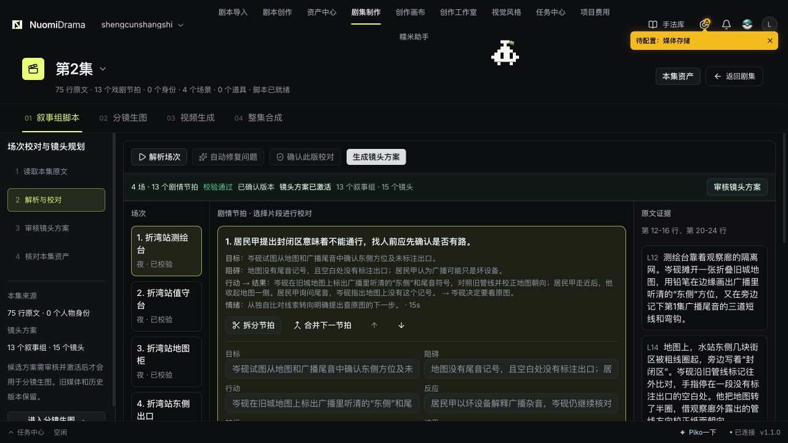

### 7.3 导演方案审核、迁移与激活

点击“审核镜头方案”，选择版本历史中的目标版本，比较新旧叙事组、镜头数量、场景与时间、镜头动作、观众注意点及资产需求。结构编辑会派生新版本，不是直接覆盖旧版本。

在“资产迁移审核”检查旧素材建议绑定到哪个新镜头，明确接受适合的迁移；风格不同的素材可能只适合作参考。完成必要校验后“激活此版本”，此后下游读取该生产版本。需要回退时选择历史版本恢复；不需要的草稿使用“放弃草稿”。

创作审查建议与结构性校验不同：优先处理原文遗漏、顺序和硬场景边界，不因普通创意建议无限重做。激活按钮不可用时先看当前版本状态与校验原因，不重复启动新规划。

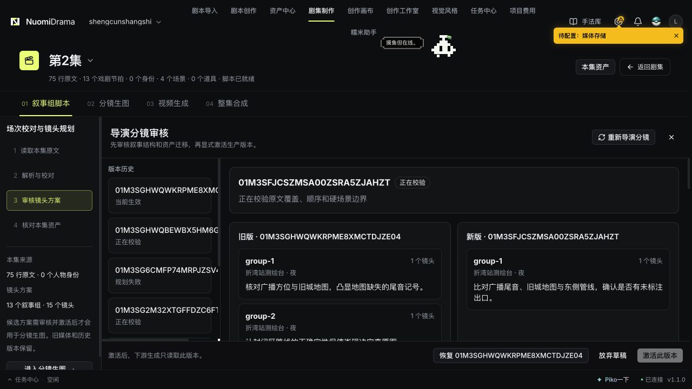

### 7.4 分镜生图

1. 进入分镜生图，选择叙事组并阅读剧情目标。
2. 右侧核对目标画幅 9:16 或 16:9、模型、分辨率及风格；“实图设置”调整生成配置，“修改风格”调整视觉方向。
3. 点击“检查参考并生成分镜”，核对人物身份、场景和道具引用，确认后生成。
4. 完成后打开“渲染多宫格”检查整组，查看自动切分状态，再逐一检查“切分格位检查”。
5. 整体需重做用“整组重新生成”；局部问题使用对应“重新生成分镜图”。在“查看分镜来源与候选”核对输入及历史。

目标画幅调整仅影响后续生成，已有素材需重新生成或重新切分才会变化。请求尺寸与实际输出可能不同，页面同时显示时应以实际素材为准。草图构图预演是可选步骤；需要更细设计时进入“导演自定义”或“3D 预演”。

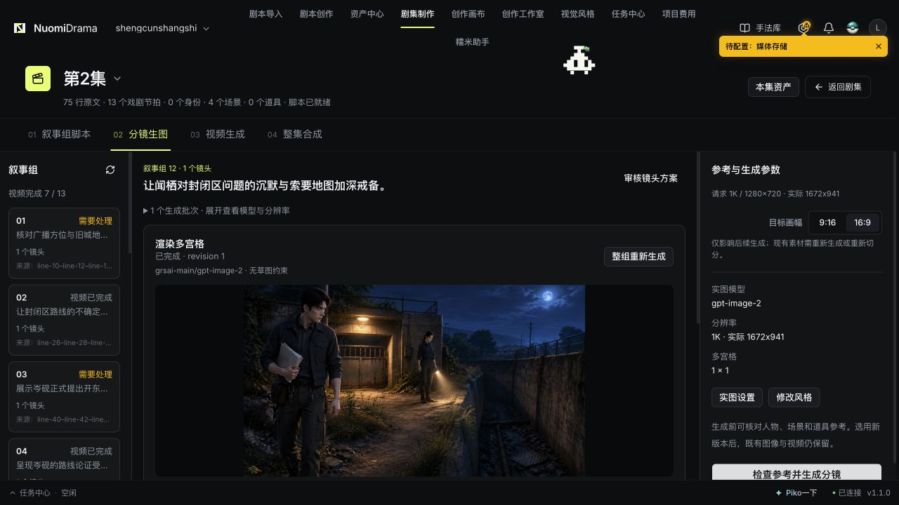

### 7.5 视频模型、模式与参考

入口：视频生成 → 选择组 → 右侧“视频参考与参数”。先选视频模型，再选当前可用模式。Ref2VA 用多参考素材约束主体与场景；I2VA 使用起始图；FL2VA 使用首尾图。其他模式只在当前模型支持且输入满足时使用，标“缺输入”的项目不能直接选择。

Ref 工作流默认应与多参考模型匹配；“自动”会显示实际解析到的模式。不同工作流不能只靠切换模式名称互换，先检查模型和输入。

1. 点击“管理参考图”，从候选资产添加，或上传临时参考图。
2. 检查每张 Picture 对应主体、描述及排序，按需上移、下移或移除。
3. 对人物描述使用可辨认的身份特征，场景描述交代地点与布局；避免让一张角色参考同时承担无法辨认的多个身份。
4. 点击“保存参考图”，确认已选数量在当前上限内；上限随配置而变，截图为 5 张。

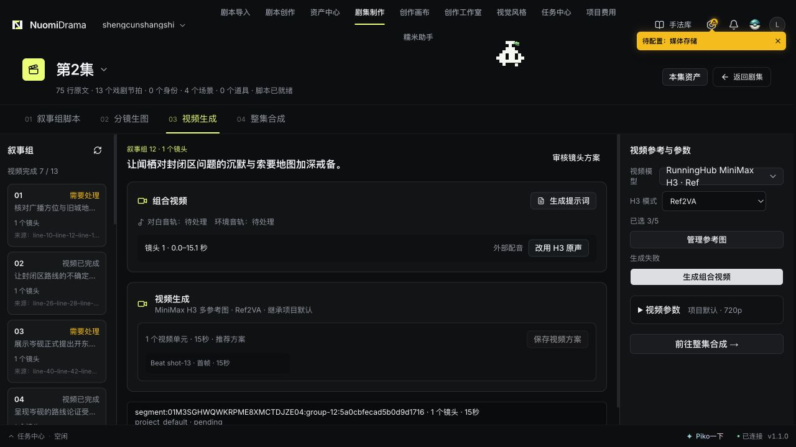

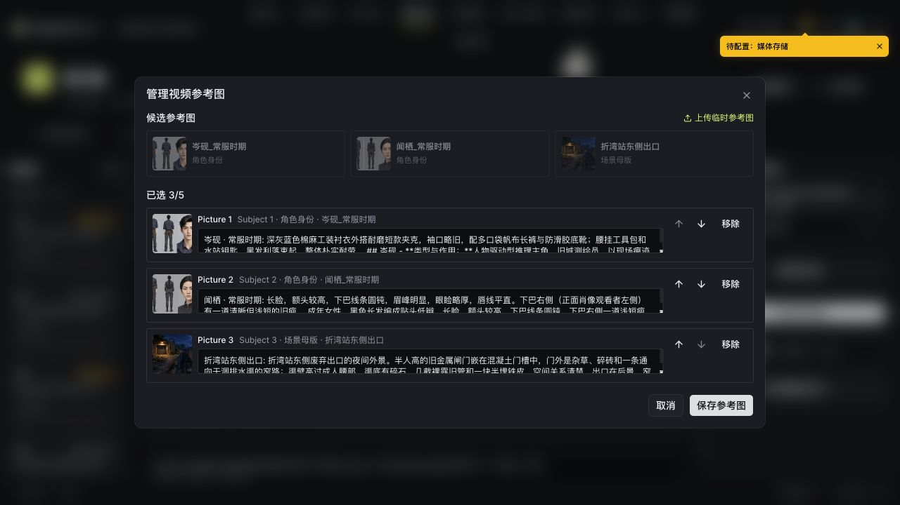

### 7.6 视频方案、声音与生成

中部视频方案显示单元、时长及采用的首帧/首尾帧组织方式。多 Beat 时可调整相邻关系合并或拆分；改动后先“保存视频方案”，保存后重算时长。视频模型模式和单元分组方案不是同一个设置。

“生成提示词”准备动作、镜头与主体说明；核对对白音轨、环境音轨以及每个镜头的声音方式。外部配音使用相应声线；需要模型自带声音时使用可用的“改用 H3 原声”。不要同时保留互相重复的对白轨。

展开“视频参数”查看分辨率等项目默认或本次覆盖值，确认后点“生成组合视频”。排队或运行期间按钮禁用，去任务中心看当前步骤。生成成功后播放当前组，检查人物、动作、台词、结尾是否完整，再进入合成。

### 7.7 “再次生成”不可点击的处理顺序

先看页面明确原因：模型未配置 → 补模型/工作流；模式缺输入 → 补首帧、尾帧或参考；参考未保存 → 保存参考；方案有改动 → 保存视频方案；工作流与本组不同步 → 点击“同步本组视频模型”或重新选择模型；排队/运行中 → 等待或查看任务。

已经失败本身不应被理解成永远不能重试。若错误是 storyboard_prompt_blocked，且 transport_called 为 false，表示在提示词规划阶段停止，尚未提交视频供应商。检查说话人身份映射、动作起始状态与模式是否匹配；不要把 Ref 参考强行当成 I2VA 的精确首帧要求。修正后从当前组重新生成。

### 7.8 整集合成

“整集合成”显示本集片段和待处理组。点击“第 N 组 · 前往处理”修复缺失片段；“刷新片段”更新列表，逐个打开可播放片段核对顺序。来源有更新提示时，判断现有视频是否仍可用，按页面是否允许合成处理，不一律全部重做。

在“输出与下载”选择分辨率、是否添加字幕，需要片头时点“制作片头”。满足条件后“合成剧集”，完成后播放成片并下载。可“导出 SRT”交给字幕工具，或“导出 ZIP”取得当前导出包；导出包内容以实际文件清单为准。

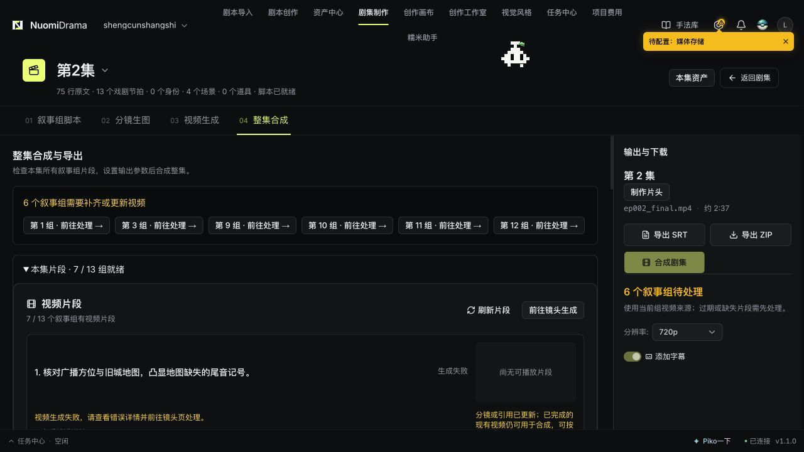

## 8. 创作画布

### 8.1 画布管理与导航

入口：创作画布。素材抽屉中切换“项目画布”“主线资产”，打开我的画布或其他画布；输入名称后新建。点击“添加节点”，也可按 Tab 或双击空白处打开菜单。缩放选项、画布缩略图和“整理/定位画布”帮助找回节点；可开启对齐吸附、隐藏连线或显示 FPS。

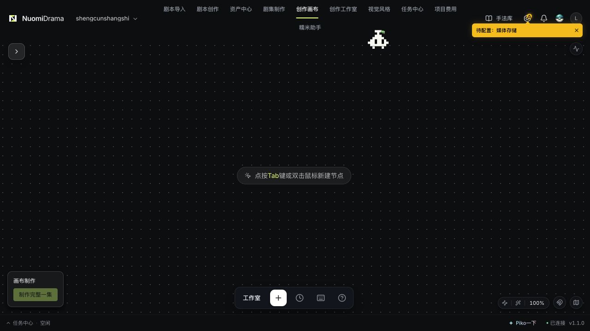

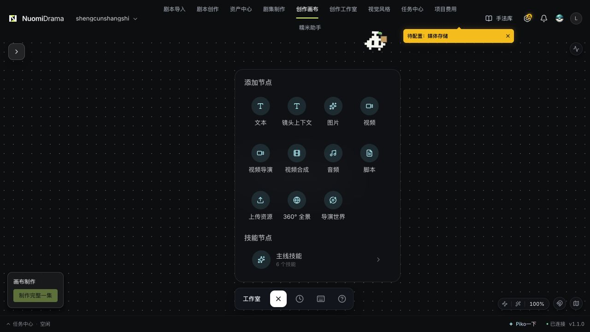

### 8.2 节点的用途

|节点/入口|如何使用|输出或注意点|
|---|---|---|
|文本|输入提示词或待处理文字，连接支持的下游|供生成引用的文本|
|镜头上下文|提供镜头相关背景与制作语境|避免下游缺少剧情对象|
|上传资源/图片|导入已有素材，或在图片节点写提示词生成|图片候选与参考|
|脚本|填写整集内容，作为后续规划上游|制作文字输入|
|主线技能/分镜生成|选择对应制作技能，提供上游输入|规划或分镜结果|
|视频|选择模型、输入模式和参数，执行生成|视频候选|
|视频导演|组织参考图与分段剧情、手法、生成参数|分段视频规划及结果|
|音频|输入文本、选择声音相关配置并生成|声音素材|
|视频合成|接入视频，核对顺序与声音再合成|组合视频|
|360° 全景|接入全景，调整方向与视场，截取视角|向下游提供截图|
|导演世界|使用可用三维场景进行取景|空间参考|
|配乐台|由视频相关入口打开，组织音乐与时间线|配乐版视频|

“主线技能”展开后选择当前可用技能。具体节点是否能执行由上游类型、保存状态和模型配置决定，节点存在不表示输入已经齐全。

### 8.3 连线与单节点生成

从上游输出连接到下游输入，确认目标节点显示所需参考，再填写提示词。音频节点接受文本上游；视频导演接受图片类和分镜节点；配乐台接收视频或合成结果；音频可作为视频或合成的声音输入。

图片参数包括模型、尺寸/比例、数量及参考；视频参数包含模型、模式、时长、质量、声音及数量，具体选项随模型变化。不要把所有模型都写成支持同一时长或分辨率。

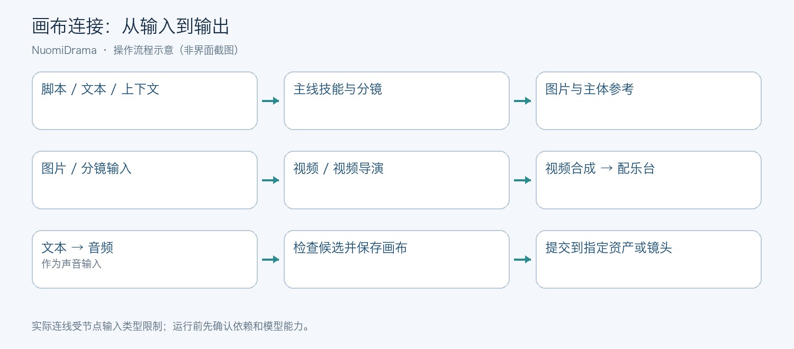

### 8.4 视频导演与案例借鉴

选中视频导演节点，接入图片或分镜，确认参考角色和场景。编辑每一分段的剧情提示词、时长、手法与模型参数；使用“选择手法”查看适合当前动作的设计。Ref 是该功能的重要默认输入路径，但仍要核对当前模型支持范围。

案例参考从“当前分段 → 选择手法 → 案例”进入：选案例 → 填当前剧情 → 选借鉴维度及参考依据 → “生成参考方案” → 审阅并编辑建议提示词 → “确认应用到当前分段”。应用到画布草稿后，检查保存状态。全局浏览案例不会自动修改分段。

### 8.5 运行、恢复和提交

选中节点后可“运行选中节点及上游”；未选择节点且存在最终节点时使用“制作完整一集”。系统按依赖执行，入口禁用时先补终点或上游、保存画布并检查输入提示。

“提交结果待核实”或 blocked 状态优先用“恢复检查”；明确失败使用“重试失败节点”；需要终止后续执行用“停止”。状态不明时不要反复重新生成，远端可能已经接受请求。

生成候选需要正式采用时，在提交入口核对项目、集数、镜头或资产目标，确认后提交。自由候选需手动选目标；画布未保存或存在冲突时先解决保存问题。提交成功应能看到具体目标，随后去对应制作页核对结果。

### 8.6 历史、全景和快捷操作

“历史记录”查已有结果，“快捷键”查看当前版本的移动、选择与整理操作。全景查看器调整视场角、方向修正和正面朝向，导出当前视角或多格截图；把需要的截图作为下游参考。不要把全景输出连线理解为完整三维动作控制。

### 8.7 配乐台

1. 从视频或视频合成结果打开配乐台，选择音乐库、已有候选或上传音乐，先试听。
2. 选择全局配乐或自由选段，指定起止范围，点“放入选区”。
3. 调整片段的时间线起点、音乐源入点、长度、音量、淡入淡出与循环选区。音量范围为 −60 至 +6 dB，避免盖过对白。
4. “保存草稿”后“导出配乐版”，生成新版本并保留原片。
5. 可收藏到项目、将候选存入个人库，维护名称、标签、人声状态与归档。

AI 生成配乐需对应配置就绪。已有远端任务 ID、查询暂停时使用“恢复查询（不重新生成）”。关闭未保存草稿会提供继续编辑、放弃本次修改、保存并关闭。

## 9. 工作室、风格与手法库

### 9.1 创作工作室总览

入口：创作工作室，包含 Agent Team、角色造型室、导演自定义、3D 预演、片头制作。由具体人物、镜头或合成页进入时携带来源，完成后可返回来源。加载失败先“重新加载”，不等于保存草稿丢失。

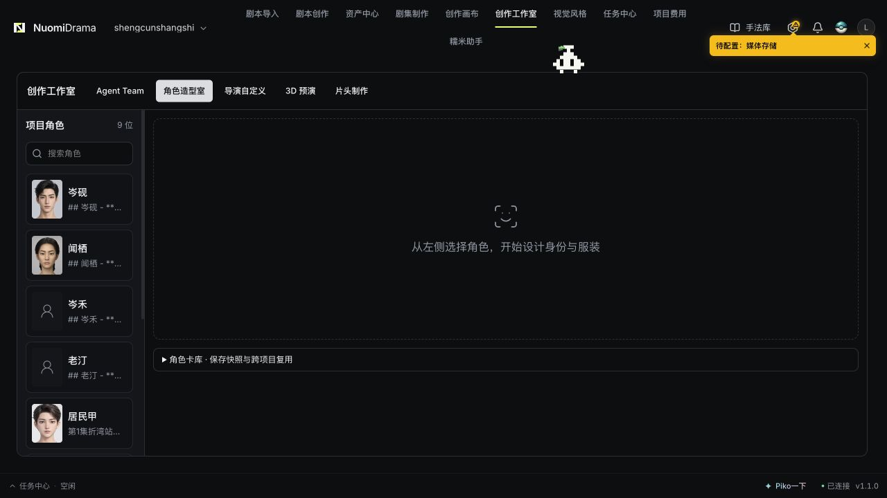

### 9.2 Agent Team：创作方法管理

选择创作角色与子任务，编辑方法和资源，点“保存草稿”。查看“待启用差异”后“启用已保存草稿”，只影响之后新建任务；需要恢复时“回滚至 v…”。未接入制作流程的子任务可能允许保存但不允许启用，按页面提示处理。

试运行先选择已保存输入、目标集；编剧任务填写总集数与要求，再“开始双侧试运行”。对比基线和草稿结果，可能产生多次模型费用，产物是独立候选，不直接写入正式制作。提交结果不明确时用“按原请求重试提交（不会重复创建）”；某侧失败可只重试该侧。

模板或资源仍在编辑中时，先发布、放弃或确认该次编辑，再保存团队。草稿、启用和试运行是三个不同动作。

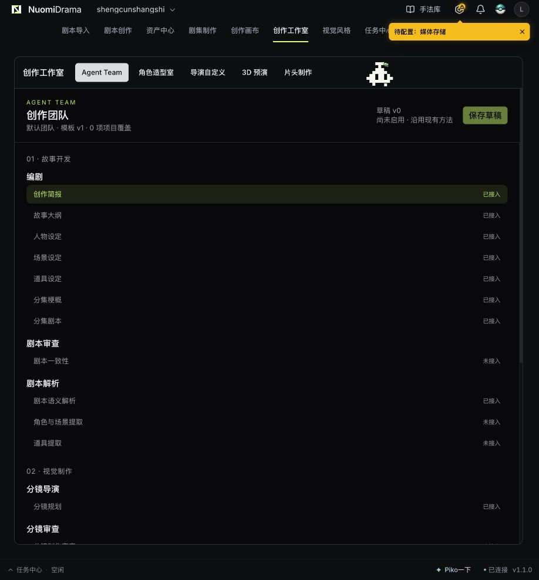

### 9.3 角色造型室

搜索并选择角色，进入“基础身份与面部”确认人物，再在“服装造型”探索服装。审阅候选和角色影响范围后采用；切换角色前处理未保存内容。展开“角色卡库 · 保存快照与跨项目复用”管理可复用快照，使用前核对角色、风格和目标项目，避免把参考卡误认成已绑定的生产资产。

### 9.4 导演自定义

“配置来源”选择内置预设、自建配置或导入个人方法。导入可粘贴文字，或使用 TXT/MD/PDF/DOCX（最多 10 MB，扫描件不做 OCR），点“提取文字配置”。编辑名称、叙事节奏、运镜、构图、人物表演与补充方法后“保存配置版本”。

旧配置可“导入团队草稿（不启用）”。镜头建议需“采纳此镜头”或“采纳全部建议”，再“打开方案审阅与生成”。选择预设本身不调用模型；团队状态读取失败时先“重试读取团队状态”。

### 9.5 3D 预演

1. 从项目角色添加演员，或创建简化人形演员；设置场景、参考图片、灯光方向及亮度。
2. 用“移动演员”“动作终点”“放置机位”“画线运镜”“添加物件”在画面操作。
3. 时间轴添加走、跑、转身、坐下，拖动片段调整起点，拖边缘调整长度；精细参数用数值编辑。
4. 绘制摄影机路径后“应用画线路径”或取消；应用会替换对应时间段的机位点。
5. 点击“播放”预演，保存版本，再“导出摄影机参考帧”或“导出白模动作视频”。

“快速动作指令”是免费本地固定语法，先解析、编辑再采用；“生成 AI 预演建议（可能计费）”是另一条模型调用路径，结果先审阅。参考图片仅用于构图参考，导入大小按页面限制。

当前视频模型尚未连接预演动作控制。导出参考帧或视频不会自动用于生成，也不保证逐帧复现；需回画布添加为参考。此边界决定了预演用于表达和检查方案，而非保证最终动作。

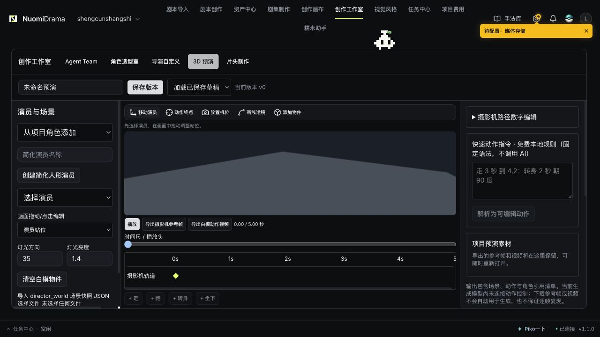

### 9.6 片头制作

新建片头或加载保存草稿，上传 PNG/JPEG/WebP 底图，或选已有成片并指定时间“使用此帧”。在片名设计中填写片名、副标题，选可用字体、颜色、位置、对齐与字号，再设置文字特效。

设置 1—30 秒时长及 16:9、9:16 或 1:1 比例；需要接入剧集时选择“插入当前集片头”。先“播放模板”预览，再“渲染新候选 · 本地免费”。完成后查看、采纳、下载 MP4，最多比较两个候选；采纳后还要保存草稿才记录采用版本。失败可重试该候选，本地渲染环境和字体未就绪时先处理提示。

“插入当前集片头”需要先选择已有成片，否则输出独立片头。底图上传最大 20 MB；不上传可用纯色背景。“可选 AI 背景”与本地模板渲染分开，使用 AI 背景前检查模型与费用。预览中拖动十字调整片名，方向键微调，Shift 加方向键加速；文字独立渲染，改文字不必重新生成背景。

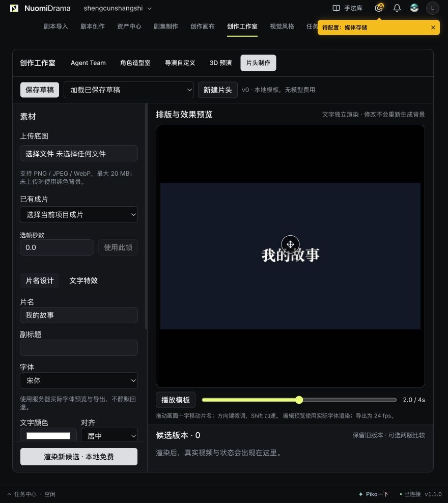

### 9.7 视觉风格

进入“视觉风格”，左侧选风格查看。预设只读，自定义可编辑；当前默认有标识。点击“创建风格”，填写小写英文/下划线 ID 与名称，可上传 PNG/JPEG/WebP/GIF 参考图提取参数，也可手工填写。

核对 UI 标签、风格指令、避免指令与 Tag；结构化表单或“JSON 编辑”修改后保存，再点“应用到项目”。保存自定义条目不等于项目已使用。修改默认风格影响后续生成，不会自动替换旧素材。自定义可重命名、重新上传参考或删除，先确认项目仍有有效默认。

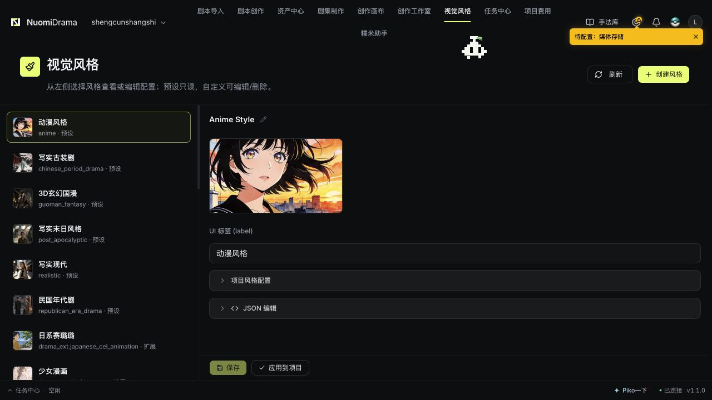

### 9.8 手法库与案例

右上角打开“手法库”，按情绪、动作、镜头搜索，结合用途筛选。点卡片读动作节拍、镜头与使用条件，可收藏供跨项目查找。示意卡片为手法解释，不代表某模型已生成过该效果。

案例支持搜索、来源/用途筛选、分页、媒体预览、参考提示词与原始出处。需要用到当前镜头时，从视频导演分段中的案例入口生成参考方案再确认应用。没有选原文依据时，按要求补至少 10 字的画面描述。来源声明不等于素材使用授权。

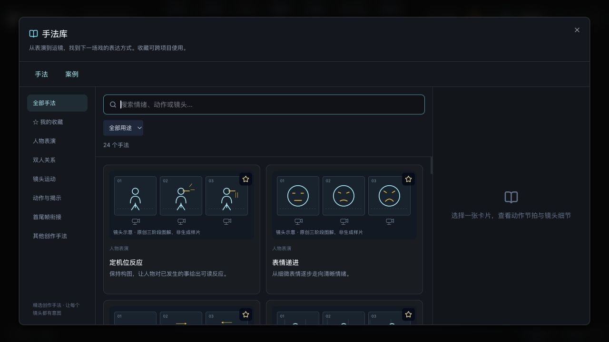

## 10. 糯米助手与全局辅助入口

入口：项目 → 糯米助手。先确认当前项目，在输入框描述目标、集数、组号和限制。例如：“分析第 2 集第 12 组生成失败的原因，先不要重生成”。有素材依据时添加附件，不需要的附件先移除。

点击发送后查看文本与工具结果；需要中止当前回答时停止。支持语音输入及停止语音，浏览器需获得麦克风权限。排队消息可检查或移除。工具执行结论以返回结果和业务页面为准，助手描述不能代替实际生成成功。

顶部“搜索消息”查对话，“显示工具事件”展开操作过程；“清除会话”会影响项目会话上下文，更换助手运行时后按说明使用。不要将清除会话误认为删除项目资料。

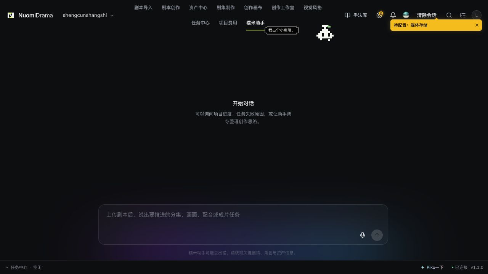

通知入口用于查看系统事件，底部任务状态用于检查后台活动。个人信息入口查看账户相关界面；搭子和 Piko 小游戏属于辅助陪伴功能，不参与成片制作和质量判定。

## 11. 任务中心与费用管理

### 11.1 查看任务、取消与清理

进入任务中心，查看类型、项目/集数/范围、当前步骤、进度与状态。展开任务读错误、日志和结果；“查看任务结果”返回对应业务页面。运行中可取消，结束后可删除记录或“清理已完成”，用“刷新”获取最新状态。

任务中心没有通用的“重试所有失败”操作。重试应回具体制作页修复输入，或在画布使用“重试失败节点”。删除记录不等于撤销生成媒体；取消也不保证供应商未产生费用。

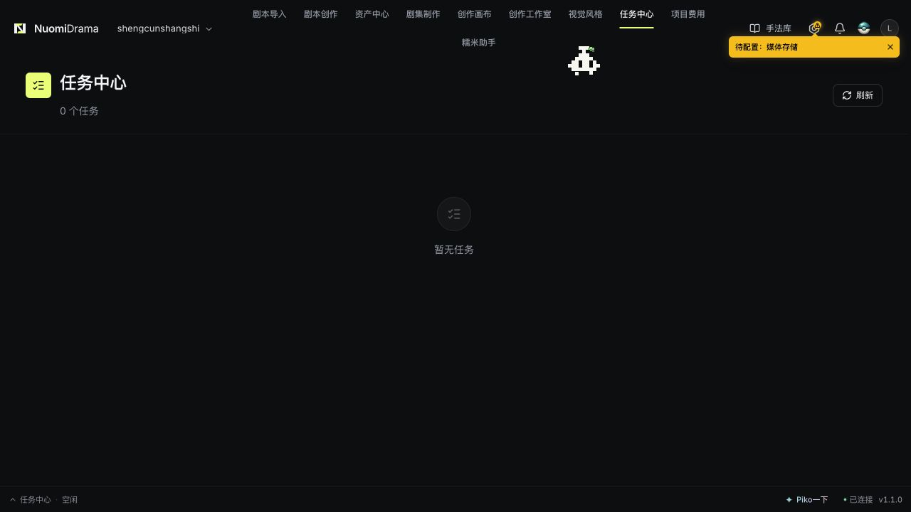

### 11.2 读懂项目费用

项目费用按全周期展示，以北京时间记录；人民币和 RH 币独立统计，不直接相加。已确认费用来自账单或计费回执，估算来自用量与价格规则；待核算、金额未知都不代表免费。共享订阅是账号固定费用，可能跨项目使用，不分摊进本项目按量总额。

点击“刷新”，核对“更新于”时间；查看每日或累计趋势，点日期看明细；点渠道/媒体分类进入筛选。调用明细可按渠道、媒体类型、费用状态过滤，点“查看”检查具体用量与来源，“清除筛选”恢复列表。刷新失败时可能保留上次快照。

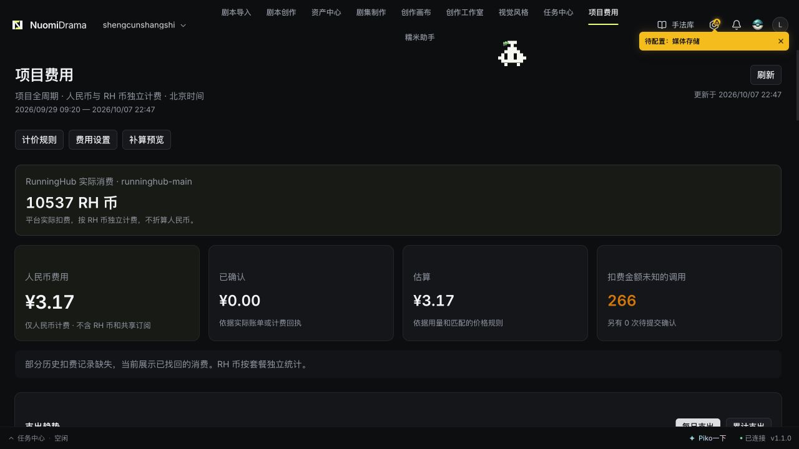

### 11.3 计价规则、订阅与补算

“计价规则”先选与供应商/模型匹配的预设；需要高级规则时展开自定义，填写规则 ID、版本、渠道、账号、模型/工作流、媒体类型、生效区间、币种和单价项。单价项区分单位、计费基数、步长和最低用量；不要把每秒价格填成每次调用价格。非人民币按需要填写汇率；RH 币保持独立。

“费用设置”管理相应的计费配置与订阅信息，核对账号、生效周期、币种和来源再保存。规则变更使用新版本或停用旧版本，未来尚未生效的版本不能按早于生效时间停用。

历史费用需要补算时先“补算预览”，核对影响范围与规则后再执行页面提供的确认动作。补算是费用记录处理，不是重新生成视频；也不会代替供应商实际账单。

## 12. 交付检查与常见问题

### 12.1 成片交付清单

合成完成后，从头到尾播放一次，检查集号和片头、组顺序、角色和道具、对白/解说、字幕、音量及结尾。发现局部问题定位到组，修复后重新合成。使用页面下载入口或播放器下载保存 MP4；需要字幕或素材包时导出 SRT/ZIP。下载完成后打开本地文件确认可播放。

### 12.2 常见问题处理表

|现象|先检查|下一步|
|---|---|---|
|视频按钮灰色|模型可用性、模式输入、参考/方案保存、运行状态|按第 7.7 节处理具体提示|
|Ref 无法切换或模型与工作流不一致|是否选到多参考工作流，是否支持目标模式|同步本组视频模型，补齐相应输入|
|提示词阶段失败，未调用供应商|身份对应、初始状态、动作与输入模式|修正规划输入后重试当前组|
|画面角色不一致|采用版本、身份/服装、参考排序和描述|先修正参考，再重做受影响结果|
|生成了但主线没变化|候选是否已采用，画布是否提交成功|核对目标并采用/提交|
|改了风格但旧图没变|修改只作用于后续生成|按需重生受影响素材|
|素材上传失败|媒体存储状态、URL 可访问性、文件类型|配置存储并重试上传|
|任务一直排队|并发占用、服务状态、供应商额度|查看任务与设置，不重复提交|
|画布提示提交结果待核实|远端是否已接受任务|先恢复检查，避免重复计费|
|合成按钮不可用|缺失组、可用片段、当前来源|按“前往处理”补齐具体组|
|有视频没声音|原声/外部配音选择、角色或旁白声线、音轨状态|补声音后重新检查合成|
|QC 不可用|技术失败还是内容确有问题|有人工采用入口时核验后继续|
|助手说完成但页面没结果|工具结果、任务 ID、目标项目与版本|刷新目标页并核对实际产物|
|费用为“—”|是否缺规则或扣费回执|查看明细，不按免费理解|
|历史素材显示过期|当前输入与旧产物版本不一致|判断能否复用，按提示局部更新|

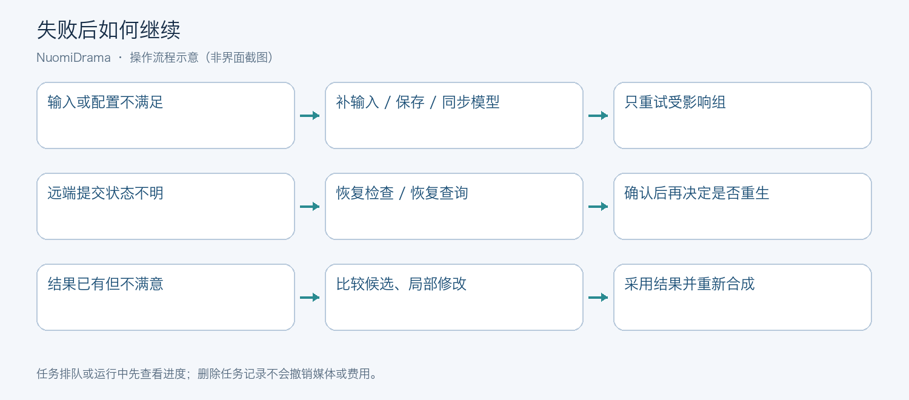

### 12.3 提交问题时带什么

记录项目、集数、叙事组/节点、模型和模式、发生时间、任务 ID、完整错误与页面截图，并说明最后一次操作。涉及凭证时只说明“已配置/连接失败”，不要把 API Key、访问令牌或签名链接公开贴到手册与群聊。

本手册核对了界面操作与当前实现；采图未执行收费生成、未修改项目生产资产。模型生成效果与供应商可用性需在实际制作时检查。
